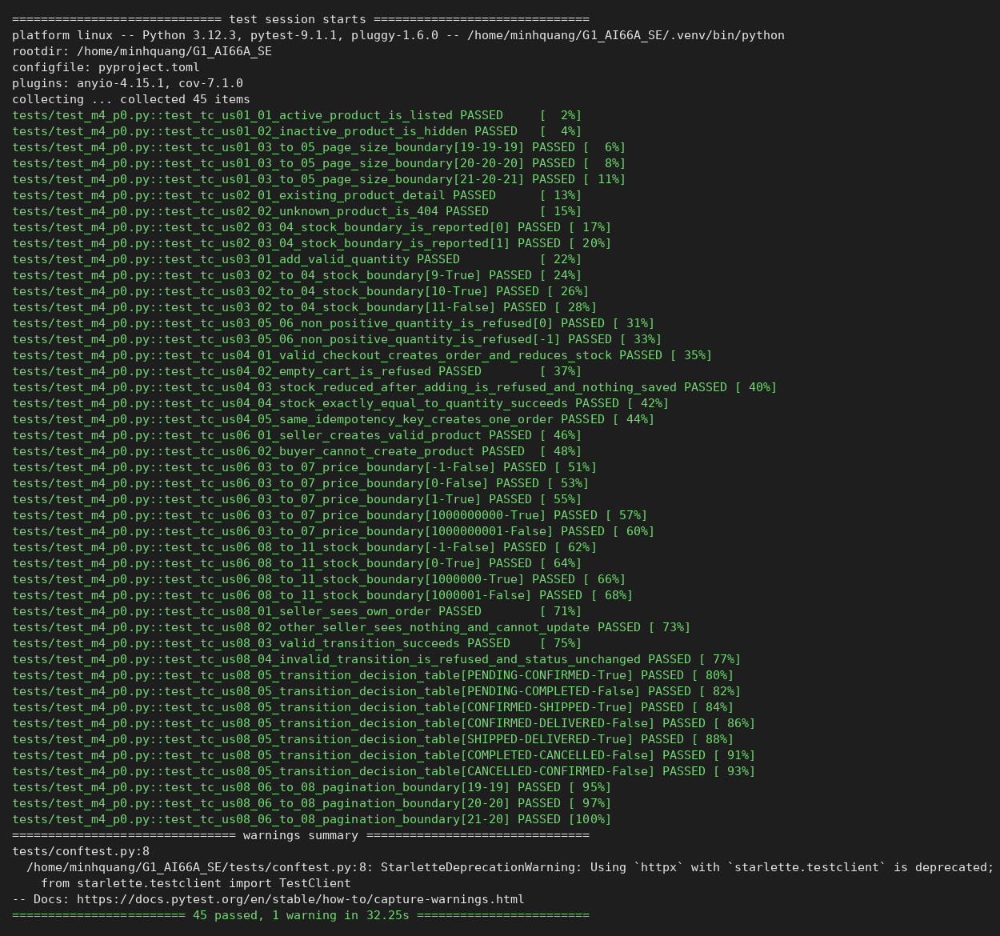

# Team01_M4 — Milestone 4

```
Team:           Team 01 — Mini Marketplace (G1_AI66A_SE)
Topic:          Mini Marketplace — Milestone 4: automated testing
Members:        Nguyen Thuy Quynh, Nguyen Quang Minh, Nguyen Ho Nhat Minh, Le Duc Minh  (IDs: FILL IN)
Product Owner:  @leducminh290506-eng
Scrum Master:   @FILL-IN (Sprint 4, must differ from Sprint 3: @teddywristh)

Repository:     https://github.com/SE-FDA-NEU/G1_AI66A_SE
Project board:  FILL IN
Setup guide:    https://github.com/SE-FDA-NEU/G1_AI66A_SE/blob/main/docs/SETUP.md

Submitted by:   FILL IN
```

## Page 2 — Project board screenshots

**Submission day (2026-11-02):** board `g1_ai66a_se` (SE-FDA-NEU). Todo 1, In Progress 0, In review 0, Done 105.


## Page 3 — Output of `python -m pytest tests/test_m4_p0.py -v`



---

## Testing (Milestone 4)

Run everything: `python -m pytest -v` (setup in [SETUP.md](SETUP.md)). Run only the
P0 test cases of section 2: `python -m pytest tests/test_m4_p0.py -v`.
Per-task regression notes written earlier in the project are kept in
[testing-task-notes.md](testing-task-notes.md).

### 1. What we test, and why

| Layer | Test | Why |
|---|---|---|
| Services (`src/services/`: cart, checkout, pricing, order states) | unit tests, plus service tests on a temporary SQLite file | Business rules live here (stock limits, idempotency, price maths, status transitions); a mistake here costs money or stock |
| Repository / database (`src/models`, `src/database.py`) | tests on a temporary SQLite file with foreign keys on | Checks constraints, rollback after failure and migrations |
| Routes (`src/api/`) | FastAPI `TestClient` against a temporary database (`tests/test_m4_p0.py`, `test_p0_flows.py`) | Status codes, authorization by role, and that a refused request writes nothing |
| Interface (`src/web/static/*.js`, HTML) | DOM scripts (`node tests/*_ui.mjs`) and browser tests in CI; not part of `tests/test_m4_p0.py` | Checked by users in Milestone 3; browser tests are slower and need Chrome, so they are not the M4 P0 cases |

Risk: we tested checkout and cart most heavily (atomic stock deduction, idempotency
key, stale stock, concurrent requests, rollback), because they move money and
inventory and a partial write is hard to repair. Seller product limits and the order
status state machine come next: they are rules with numbers or a table where an
off-by-one or a wrong transition is easy to introduce. Catalog and detail pages
are read-only, so they get fewer cases.

Expected values in section 2 come from the requirements (limits, prices, statuses),
not from reading the production constants back.

### 2. Test cases for every P0 story

Kind: N = normal, E = error (a rule refuses the input), B = boundary.

| ID | Story | Input | Expected result | Kind |
|---|---|---|---|---|
| TC-US01-01 | US01 Catalog | one active product, search by its name | listed in `GET /api/v1/products` | N |
| TC-US01-02 | US01 Catalog | product deactivated by its seller | not listed | E |
| TC-US01-03 | US01 Catalog | 19 products, page size 20 | 19 on page 1, total 19 | B, below |
| TC-US01-04 | US01 Catalog | 20 products, page size 20 | 20 on page 1, total 20 | B, on the limit |
| TC-US01-05 | US01 Catalog | 21 products, page size 20 | 20 on page 1, 1 on page 2 | B, above |
| TC-US02-01 | US02 Product detail | existing code, price 123 000 | 200, price 123 000 | N |
| TC-US02-02 | US02 Product detail | unknown code | 404 | E |
| TC-US02-03 | US02 Product detail | stock 0 | 200, stock_quantity 0 | B |
| TC-US02-04 | US02 Product detail | stock 1 | 200, stock_quantity 1 | B |
| TC-US03-01 | US03 Cart | add 2 × 100 000 VND | 201, cart total 200 000 | N |
| TC-US03-02 | US03 Cart | stock 10, add 9 | 201, cart holds 9 | B, below |
| TC-US03-03 | US03 Cart | stock 10, add 10 | 201, cart holds 10 | B, on the limit |
| TC-US03-04 | US03 Cart | stock 10, add 11 | 409/422, cart empty | B, above |
| TC-US03-05 | US03 Cart | quantity 0 | 400, nothing saved | E, boundary |
| TC-US03-06 | US03 Cart | quantity −1 | 400, nothing saved | E |
| TC-US04-01 | US04 Checkout | cart 2 × 100 000, stock 5 | 201, total 200 000, stock 3 | N |
| TC-US04-02 | US04 Checkout | empty cart | 4xx, no order saved | E |
| TC-US04-03 | US04 Checkout | stock dropped 3 → 2 after adding 3 | 409, no order, stock stays 2 | E |
| TC-US04-04 | US04 Checkout | stock 2, quantity 2 | 201, stock 0 | B, on the limit |
| TC-US04-05 | US04 Checkout | same Idempotency-Key twice | 201 then 200, one order | E (replay) |
| TC-US06-01 | US06 Create product | seller, valid body | 201, price 50 000 | N |
| TC-US06-02 | US06 Create product | buyer account | 403 | E |
| TC-US06-03 | US06 Create product | price −1 | refused | B |
| TC-US06-04 | US06 Create product | price 0 | refused | B |
| TC-US06-05 | US06 Create product | price 1 | 201 | B, smallest valid |
| TC-US06-06 | US06 Create product | price 1 000 000 000 | 201 | B, on the limit |
| TC-US06-07 | US06 Create product | price 1 000 000 001 | refused | B, above |
| TC-US06-08 | US06 Create product | stock −1 | refused | B |
| TC-US06-09 | US06 Create product | stock 0 | 201 | B |
| TC-US06-10 | US06 Create product | stock 1 000 000 | 201 | B, on the limit |
| TC-US06-11 | US06 Create product | stock 1 000 001 | refused | B, above |
| TC-US08-01 | US08 Seller orders | order containing seller's product | seller lists exactly that order | N |
| TC-US08-02 | US08 Seller orders | other seller lists / updates it | empty list; 403/404 | E |
| TC-US08-03 | US08 Seller orders | PENDING → CONFIRMED | 200, CONFIRMED | N |
| TC-US08-04 | US08 Seller orders | CONFIRMED → DELIVERED | 400, status stays CONFIRMED | E |
| TC-US08-05 | US08 Seller orders | 7 pairs (PENDING→COMPLETED, CONFIRMED→SHIPPED, …) | decision table allowed / refused | E, table |
| TC-US08-06 | US08 Seller orders | 19 orders, limit 20 | 19 on page 1, total 19 | B, below |
| TC-US08-07 | US08 Seller orders | 20 orders, limit 20 | 20 on page 1, total 20 | B, on the limit |
| TC-US08-08 | US08 Seller orders | 21 orders, limit 20 | 20 on page 1, total 21 | B, above |

Note on US08: `docs/requirements.md` describes "Mark as Completed" from PENDING, but the
state machine (`src/services/order_states.py`) requires PENDING → CONFIRMED/PROCESSING
→ SHIPPED → … → COMPLETED. TC-US08-05 follows the state machine; the team must
reconcile the acceptance criterion with it.

### 3. Automated tests

All cases above are in [tests/test_m4_p0.py](../tests/test_m4_p0.py); the ID is in the
test name (`test_tc_us03_02_to_04_…`) and in the `# TC-…` comment of each parametrize
row. Tests use a temporary SQLite file per test and the FastAPI `TestClient`
(no server, no `marketplace.db`). Pure decision-table cases (TC-US08-05) call the
service function directly.

```bash
python -m pytest -v                        # whole suite
python -m pytest tests/test_m4_p0.py -v    # the 45 M4 P0 cases
```

Output of the M4 file: [docs/images/m4/pytest-m4.txt](images/m4/pytest-m4.txt)
(45 passed). Existing suites (about 1 650 tests: checkout, cart service, pricing,
rollback, concurrency, browser tests) continue to run in CI.

### 4. What the tests found

**Bug: two checkout tests were silently never run.** Ruff reported F811 (redefined
function) in CI, which was allowed to fail. `tests/test_checkout.py` defined
`test_checkout_persists_selected_payment_method_and_receipt` and
`test_checkout_omitted_payment_method_uses_legacy_cod_compatibility` twice; Python
kept the later, weaker copies, which dropped the `payment_status == "UNPAID"` and
receipt assertions. Fix: the duplicate copies were removed so the stronger tests run.

**Rule broken on purpose (red output).** In `src/services/cart.py`
`validate_quantity`, we changed `quantity < 1` to `quantity < 0`, so quantity 0 is
accepted. Result:

```
FAILED tests/test_m4_p0.py::test_tc_us03_05_06_non_positive_quantity_is_refused[0]
E   assert 409 == 400
1 failed, 1 passed
```

The code was restored (`git checkout`) and the test is green again. The test that
guards this rule is TC-US03-05.
