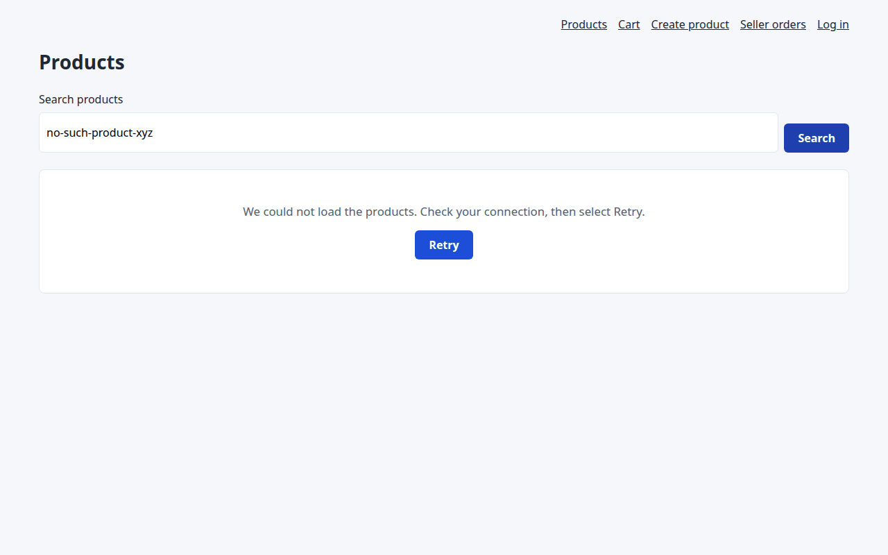
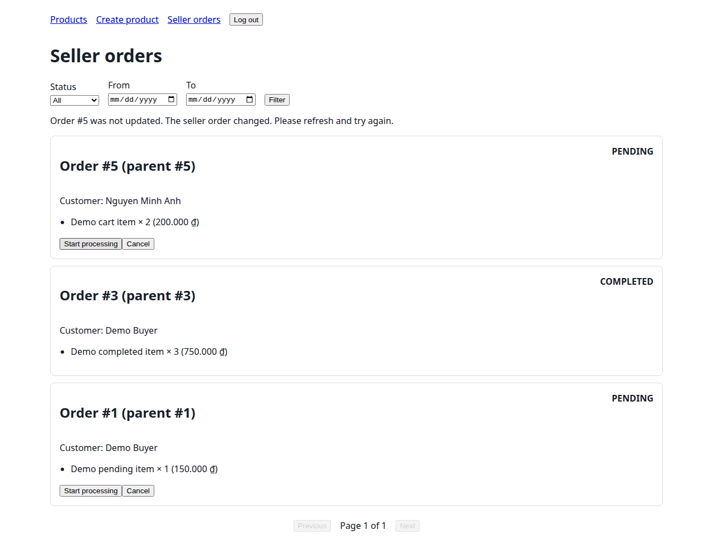

# Milestone 3 UI evidence (#85)

Milestone 3 asks that every P0 story can be finished through the interface, with real
data and clear error messages, and that `docs/ui.md` has four sections in a fixed
order. This page records what was checked, on which code, and where each requirement
is met.

## 1. Baseline

| Item | Value |
|---|---|
| Branch | `docs/85-m3-ui-requirements`, from `main` at `d1d7794` (after PRs #95 to #99) |
| Checked on | 2026-10-18 |
| Environment | Ubuntu 24.04 on WSL2, Python 3.12.3, Node 22.23.2, headless Chromium 149 driven by Playwright 1.61 |
| Data | A new SQLite file seeded with `python -m src.seed --demo` |
| Server | `uvicorn src.main:app` on that file |

The first version of this page (PR #99) recorded the screens before the fixes listed
in section 5.

## 2. Automated checks

| Check | Result |
|---|---|
| `python -m pytest` | 368 passed (359 on `main` before this branch) |
| `python -m ruff check src tests` | All checks passed |
| `node tests/checkout_ui.mjs` | Passed |
| `node tests/seller_products_ui.mjs` | Passed |
| `node tests/seller_orders_ui.mjs` (new) | Passed |
| CI | Runs the three page-script checks after pytest |

`tests/test_ui_docs_contract.py` checks that `docs/ui.md` has exactly the four
required sections in order, that each P0 story has an allowed status and a served
route, that every wireframe states its purpose and the endpoints it calls, that the
cart is drawn in four states, and that every message in section 3 is shown by the
code, with an existing error code, business rule and test. It also checks the README
first screen and that no page shows "Something went wrong" or "Error 422".
`tests/test_navigation.py` checks that every story starts from a link. Each of these
tests was seen failing when the document or the link it protects was changed.

## 3. Milestone 3 requirements

| Requirement | Where | Status |
|---|---|---|
| `docs/ui.md`, section 1: P0 stories and status, with the updated M1 screen flow | [ui.md section 1](../ui.md#1-p0-stories-and-status); flow in [images/ui/screen-flow.png](../images/ui/screen-flow.png) | Done |
| Section 2: one wireframe per P0 screen with "The user comes here to …" and its endpoints; one screen in four states | [ui.md section 2](../ui.md#2-wireframes); the cart in 2.3 | Done |
| Section 3: at least four messages with API error code, business rule and exact text, none generic | [ui.md section 3](../ui.md#3-error-messages): 16 messages | Done |
| Section 4: at least one change since M2, with design.md updated in the same PR | [ui.md section 4](../ui.md#4-what-changed-since-m2); design.md sections 3.3 and 6.4 | Done |
| Wireframes and screenshots in `docs/images/ui/` | 28 screenshots and the screen flow | Done |
| A P0 story can be completed without typing a URL | Section 4 below: all six, from `/` | Done |
| Breaking a business rule shows a clear message | M3-14 (stock, BR2), M3-22 (price, BR9), M3-25 (seller order) | Done |
| README first screen lists the P0 stories and where each starts, with test accounts | [README](../../README.md#p0-stories-and-where-each-one-starts) | Done |
| `docs/SETUP.md` still works and lists the test accounts | Section 8.1 lists the accounts; `/` and page checks updated | Done; the Sprint 3 "Tested by" run is still open in #84 |

## 4. Browser walkthrough

Each story was started from `/` and followed with links and buttons only; direct URLs
were used only for the pages a shared link would open (M3-09, M3-10) and a second
account (M3-19, M3-20). "Shown" is the text on the page.

| ID | Story | Step | Account | Shown | Screenshot |
|---|---|---|---|---|---|
| M3-01 | US01 | Open `/` | Guest | The catalog at `/products` | — |
| M3-02 | US01 | Catalog loading | Guest | Eight skeleton cards; "Loading products…" | [catalog-loading](../images/ui/catalog-loading.png) |
| M3-03 | US01 | Catalog data | Guest | 20 cards; navigation "Products, Cart, Create product, Seller orders, Log in" | [catalog-data](../images/ui/catalog-data.png) |
| M3-04 | US01 | Search with no match | Guest | "No products available at the moment." | [catalog-empty](../images/ui/catalog-empty.png) |
| M3-05 | US01 | Catalog request blocked | Guest | "We could not load the products. Check your connection, then select Retry." and Retry | [catalog-error](../images/ui/catalog-error.png) |
| M3-06 | US02 | Select the "Wireless Mouse" card | Guest | `/products/P-100`, "In Stock (10 available)" | [detail-in-stock](../images/ui/detail-in-stock.png) |
| M3-07 | US02 | Quantity 2, Add to Cart | Guest | Sent to login, then back to `/products/P-100?quantity=2` | [login](../images/ui/login.png) |
| M3-08 | — | Wrong password | Guest | "Email or password is incorrect." | [login-error](../images/ui/login-error.png) |
| M3-09 | US02 | Out-of-stock product | Guest | "Out of stock"; Add to Cart disabled | [detail-out-of-stock](../images/ui/detail-out-of-stock.png) |
| M3-10 | US02 | Unknown product | Guest | "This product does not exist or is no longer for sale. Go back to the catalogue to choose another one." | [detail-not-found](../images/ui/detail-not-found.png) |
| M3-11 | US08 | Seller orders link | Guest | Sent to `/login?return_to=%2Fseller%2Forders` | — |
| M3-12 | US03 | Log in, then Cart link; loading | `user@example.com` | Three skeleton lines; "Loading your cart…" | [cart-loading](../images/ui/cart-loading.png) |
| M3-13 | US03 | Cart data | `user@example.com` | "Demo cart item", total "200.000 ₫", "No shipping fee is added at checkout." | [cart-data](../images/ui/cart-data.png) |
| M3-14 | US03 | Quantity 999 (breaks BR2) | `user@example.com` | "Cannot add more than 12 items (available stock limit)"; quantity stays 2 | [cart-stock-error](../images/ui/cart-stock-error.png) |
| M3-15 | US03 | Cart request blocked | `user@example.com` | "Unable to load your cart. Please try again." and Retry | [cart-error](../images/ui/cart-error.png) |
| M3-16 | US04 | Checkout button; phone `abc1234` | `user@example.com` | "Phone number must contain 7 to 15 digits." | [checkout-error](../images/ui/checkout-error.png) |
| M3-17 | US04 | Valid phone, Confirm order | `user@example.com` | "Order placed successfully.", "Demo cart item (P-DEMO-CART) × 2 · 100.000 ₫ each" | [confirmation](../images/ui/confirmation.png) |
| M3-18 | US08 | Continue shopping, then Seller orders | `user@example.com` | "Only seller accounts can manage orders. Log in with a seller account." | [seller-orders-buyer](../images/ui/seller-orders-buyer.png) |
| M3-19 | US03 | Empty cart | `demo.buyer@marketplace.local` | "Your cart is empty.", "Total: 0 ₫" | [cart-empty](../images/ui/cart-empty.png) |
| M3-20 | US04 | Another buyer's order | `demo.buyer@marketplace.local` | "Confirmation unavailable." and "We could not find this order in your account. Check the order link, or continue shopping." | — |
| M3-21 | US06 | Create product link | Guest | Sent to login, then back to the form | — |
| M3-22 | US06 | Price 0, stock -1 (breaks BR9) | `demo.seller@marketplace.local` | "Please correct the highlighted fields." and a message under each field | [product-form-errors](../images/ui/product-form-errors.png) |
| M3-23 | US06 | Valid listing | `demo.seller@marketplace.local` | "Listing created", "Product code: P-…", View product | [product-created](../images/ui/product-created.png) |
| M3-24 | US08 | Seller orders link | `demo.seller@marketplace.local` | "3 seller orders found.", including order #5 from M3-17 | [seller-orders](../images/ui/seller-orders.png) |
| M3-25 | US08 | Start processing while the order changed (simulated 409) | `demo.seller@marketplace.local` | The list stays; "Order #5 was not updated. The seller order changed. Please refresh and try again." | [seller-orders-update-error](../images/ui/seller-orders-update-error.png) |
| M3-26 | US08 | Start processing | `demo.seller@marketplace.local` | Order #5 shows PROCESSING and offers Mark shipped | — |
| M3-27 | US08 | Filter CANCELLED | `demo.seller@marketplace.local` | "No seller orders found." | [seller-orders-empty](../images/ui/seller-orders-empty.png) |
| M3-28 | US03 | Products, then Cart | `demo.seller@marketplace.local` | "The cart is for buyer accounts. Log in with a buyer account to shop." | [cart-seller](../images/ui/cart-seller.png) |
| M3-29 | — | Catalog and cart at 390 px | `user@example.com` | No sideways scroll; cart controls below the image | [mobile-catalog](../images/ui/mobile-catalog.png), [mobile-cart](../images/ui/mobile-cart.png) |
| M3-30 | — | Checkout and product form at 390 px | buyer, `seller@example.com` | One column, no sideways scroll | [mobile-checkout](../images/ui/mobile-checkout.png), [mobile-product-form](../images/ui/mobile-product-form.png) |
| M3-31 | — | Seller orders at 390 px | `demo.seller@marketplace.local` | Cards, no sideways scroll | [mobile-seller-orders](../images/ui/mobile-seller-orders.png) |

No page raised a script error. "Request blocked" means the browser aborted that API
request to show the error state; M3-25 answered the status change with a `409` in
the browser for the same reason.

## 5. Changes made while checking

| Found | Fix | Commit |
|---|---|---|
| The confirmation showed "Product #46 × 2 · 100000 VND each" | Receipt items carry `product_code` and `product_name`; the page formats the price | `fix: name each product on the order confirmation` |
| `/seller/orders` had no link, showed "The access token is invalid or expired." to guests, "Failed to fetch" on network errors, and hid the list when a change failed | Navigation links, login redirect, clear messages, list kept | `fix: reach seller orders from the navigation and send guests to login` |
| Catalog and product detail showed "Something went wrong. Please try again later."; a seller's cart said only "A buyer account is required." | Messages that say what happened and what to do | `fix: replace generic page errors with messages that say what to do` |
| Another buyer's order showed only "Order not found." | "We could not find this order in your account. Check the order link, or continue shopping." | `fix: explain a missing order on the confirmation page` |

## 6. Not claimed here

- Sessions with people who have never seen the app belong to #83 and are not
  recorded yet.
- The Sprint 3 "Tested by" run of `docs/SETUP.md` by someone other than its author
  belongs to #84 and is still open.
- Screen-reader testing and browsers other than Chromium were not done.
- These screenshots have no browser address bar; the PDF for the submission needs
  screenshots taken in a normal browser window.

## 7. How to repeat

1. `python -m src.seed --demo` on a new database, then `python -m src.main`.
2. Open `http://127.0.0.1:8000/` and follow section 4 with the listed accounts
   (password `password`).
3. Run the commands of section 2.
