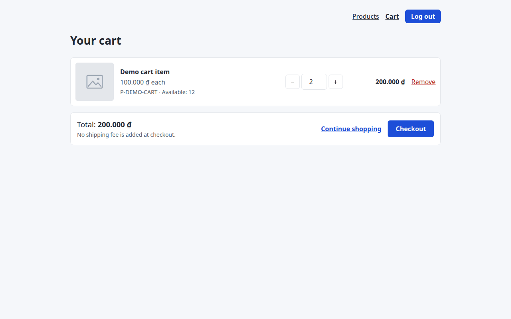
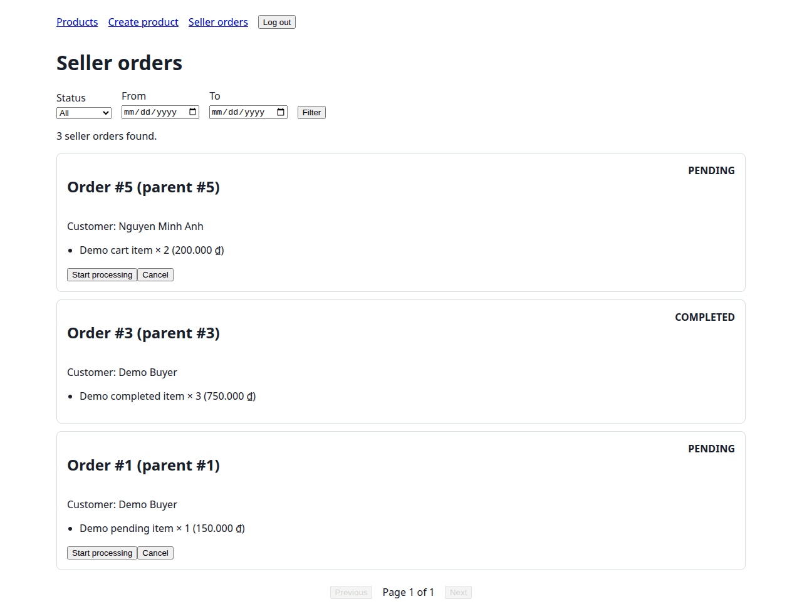
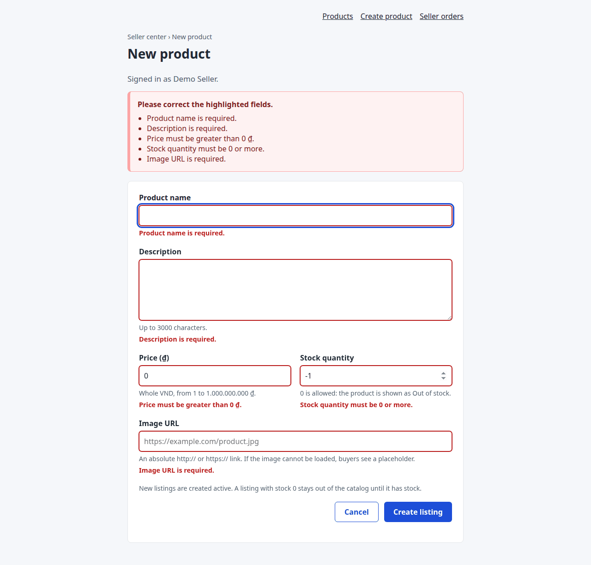

# Milestone 3 UI documentation evidence (#85)

Issue #85 finalizes the UI documentation and collects the Milestone 3 evidence for
the six P0 stories. This page records what was checked, on which code, and where
each acceptance item of #85 is met.

## 1. Baseline

| Item | Value |
|---|---|
| Branch | `docs/85-ui-docs-m3-evidence` |
| Based on | `main` at `932f480` (after PR #96), plus the open branches of PR #97 (#83, `16f37ed`) and PR #98 (#84, `1563544`), merged locally into this branch only |
| Checked on | 2026-10-18 |
| Environment | Ubuntu 24.04 on WSL2, Python 3.12.3, Node 22.23.2, headless Chromium 149 driven by Playwright 1.61 |
| Data | A new SQLite file seeded with `python -m src.seed --demo` (#84); the second run printed `Demo scenarios: already installed (unchanged)` |
| Server | `uvicorn src.main:app` on that file |

PR #97 and PR #98 are not merged into `main`; this branch builds on them so the
documentation describes the root entry (`/`) and the demo data. Merge them before
this PR.

## 2. Automated checks

| Check | Result |
|---|---|
| `python -m pytest` | 359 passed (334 on the combined baseline before #85) |
| `python -m ruff check src tests` | All checks passed |
| `node tests/checkout_ui.mjs` | Passed |
| `node tests/seller_products_ui.mjs` | Passed |
| `tests/test_ui_docs_contract.py` | 24 passed |

`tests/test_ui_docs_contract.py` is new in #85. For each of the 20 error cases in
[docs/ui.md section 3](../ui.md#3-error-messages)
it checks that the quoted UI message is shown by a page or the API, that every error
code is raised by the API, that every business rule exists in
[traceability.md](../traceability.md#business-rules), and that the named test
exists. It checks that [design.md section 3.4](../design.md#34-error-handling) lists
exactly the error codes the code raises, and that every route in the screen
inventory is served. Changing one message, rule id or test name in `ui.md` made
it fail before it was committed. It also adds the missing API check that a buyer
and a guest cannot use `/api/v1/seller/orders`.

## 3. Acceptance items of #85

| Item | Where | Status |
|---|---|---|
| `docs/ui.md` contains the required four main sections | 1 Screen inventory and navigation; 2 Screen wireframes; 3 Shared interaction and responsive rules; 4 Review checklist and implementation handoff (the four sections set in #76) | Done |
| All 6 P0 stories are included | Section 1 maps US01, US02, US03, US04, US06 and US08 to their screens, endpoints and PRs | Done |
| All required wireframes are included | Sections 2.1 to 2.8: six P0 screens, login and confirmation, redrawn from the running pages | Done |
| `/cart` contains all four states | Section 2.3 "Required cart states", with screenshots M3-11 to M3-14 | Done |
| At least 4 documented API/business/UI error cases | Section 3.2: 20 cases (UI-E01 to UI-E20) | Done |
| Error codes, business rules and UI messages match | Checked by `tests/test_ui_docs_contract.py`; the cart note that promised a shipping fee was corrected to "No shipping fee is added at checkout." | Done |
| At least 1 real API/schema/architecture change is documented | [design.md section 6.4](../design.md#64-milestone-3-api-schema-and-architecture-changes): nine changes, for example the idempotent checkout (`orders.request_key`/`request_hash`), `order_history`, `image_url` and the browser entry | Done |
| `docs/design.md` is updated in the same PR | Sections 1.4, 1.5, 3.3 (13 endpoints), 3.4 (every error code) and 6.4 | Done |
| README, SETUP and traceability are synchronized | README lists every P0 screen with its account and adds US08; SETUP updates the `/` check, the stack, the repository tree and the CI steps; traceability updates the route table, the P0 story map and BR1 to BR10 to `main` at `932f480` | Done |
| Evidence and valid screenshots are included | Section 4 below: 30 checks, 24 screenshots taken from the running app | Done |

## 4. Screens and states

Each row was checked in the browser; "Shown" is the text the page displayed.

| ID | Screen | State | Account | Shown | Screenshot |
|---|---|---|---|---|---|
| M3-01 | `/` | Browser entry | Guest | Redirected to `/products`; a JSON client still gets `"status": "running"` | — |
| M3-02 | Catalog | Loading | Guest | Eight skeleton cards; "Loading products…" | [catalog-loading](../images/ui/catalog-loading.png) |
| M3-03 | Catalog | Data | Guest | 20 cards, first "Wireless Mouse", "180.000 ₫", "In Stock"; "Page 1 of 3" | [catalog-data](../images/ui/catalog-data.png) |
| M3-04 | Catalog | Empty (search with no match) | Guest | "No products available at the moment." | [catalog-empty](../images/ui/catalog-empty.png) |
| M3-05 | Catalog | Error (request blocked) | Guest | "Something went wrong. Please try again later." and Retry | [catalog-error](../images/ui/catalog-error.png) |
| M3-06 | Detail `P-100` | Data | Guest | "In Stock (10 available)" | [detail-in-stock](../images/ui/detail-in-stock.png) |
| M3-07 | Detail `P-DEMO-OUT` | Out of stock | Guest | "Out of stock"; Add to Cart disabled | [detail-out-of-stock](../images/ui/detail-out-of-stock.png) |
| M3-08 | Detail `P-NOPE` | Not found | Guest | "Product not found." and Back to catalogue | — |
| M3-09 | Detail → login | Guest adds 2 to the cart | Guest | Sent to `/login?return_to=%2Fproducts%2FP-100%3Fquantity%3D2`; after login back at `/products/P-100?quantity=2` with quantity 2 | [login](../images/ui/login.png) |
| M3-10 | Login | Wrong password | Guest | "Email or password is incorrect." | [login-error](../images/ui/login-error.png) |
| M3-11 | Cart | Loading | `user@example.com` | Three skeleton lines; "Loading your cart…" | [cart-loading](../images/ui/cart-loading.png) |
| M3-12 | Cart | Data | `user@example.com` | "Demo cart item", "P-DEMO-CART · Available: 12", total "200.000 ₫", "No shipping fee is added at checkout." | [cart-data](../images/ui/cart-data.png) |
| M3-13 | Cart | Empty | `demo.buyer@marketplace.local` | "Your cart is empty.", "Total: 0 ₫", Continue shopping | [cart-empty](../images/ui/cart-empty.png) |
| M3-14 | Cart | Error (request blocked) | `user@example.com` | "Unable to load your cart. Please try again." and Retry | [cart-error](../images/ui/cart-error.png) |
| M3-15 | Cart | Quantity 999 | `user@example.com` | "Cannot add more than 12 items (available stock limit)"; quantity stays 2 | [cart-stock-error](../images/ui/cart-stock-error.png) |
| M3-16 | Cart | Seller opens it | `demo.seller@marketplace.local` | "A buyer account is required."; no Retry | — |
| M3-17 | Checkout | Invalid phone `abc1234` | `user@example.com` | "Phone number must contain 7 to 15 digits." | [checkout-error](../images/ui/checkout-error.png) |
| M3-18 | Checkout | Empty cart after ordering | `user@example.com` | "Your cart is empty."; form hidden | — |
| M3-19 | Confirmation | Data | `user@example.com` | "Order placed successfully.", "Order #5 · PENDING", "Total: 200.000 ₫" | [confirmation](../images/ui/confirmation.png) |
| M3-20 | Seller product form | Field errors | `demo.seller@marketplace.local` | Summary "Please correct the highlighted fields." and five field messages | [product-form-errors](../images/ui/product-form-errors.png) |
| M3-21 | Seller product form | Success | `demo.seller@marketplace.local` | "Listing created", the name, "Product code: P-…", View product | [product-created](../images/ui/product-created.png) |
| M3-22 | Seller orders | Data | `demo.seller@marketplace.local` | "3 seller orders found." with PENDING and COMPLETED cards, including order #5 from M3-19 | [seller-orders](../images/ui/seller-orders.png) |
| M3-23 | Seller orders | Start processing on order #5 | `demo.seller@marketplace.local` | Order #5 shows PROCESSING and offers Mark shipped; `seller@example.com` sees its own PROCESSING and CANCELLED orders only | — |
| M3-24 | Seller orders | Empty (filter CANCELLED) | `demo.seller@marketplace.local` | "No seller orders found." | [seller-orders-empty](../images/ui/seller-orders-empty.png) |
| M3-25 | Seller orders | Buyer and guest | `user@example.com`, guest | Buyer: "A seller account is required." Guest: "The access token is invalid or expired." (gap UI-G3) | — |
| M3-26 | Catalog, 390 px | Mobile | `user@example.com` | Two cards per row, no sideways scroll | [mobile-catalog](../images/ui/mobile-catalog.png) |
| M3-27 | Cart, 390 px | Mobile | `user@example.com` | Controls below the image, no sideways scroll | [mobile-cart](../images/ui/mobile-cart.png) |
| M3-28 | Checkout, 390 px | Mobile | `user@example.com` | One column, no sideways scroll | [mobile-checkout](../images/ui/mobile-checkout.png) |
| M3-29 | Seller product form, 390 px | Mobile | `seller@example.com` | One column, no sideways scroll | [mobile-product-form](../images/ui/mobile-product-form.png) |
| M3-30 | Seller orders, 390 px | Mobile | `demo.seller@marketplace.local` | Cards, no sideways scroll | [mobile-seller-orders](../images/ui/mobile-seller-orders.png) |

No page raised a script error during these checks. "Request blocked" means the
browser aborted that API request, to show the error state without breaking the
server.

## 5. Error cases seen in the browser

Of the 20 documented cases, these were also triggered in the browser above:
UI-E01 (M3-05), UI-E02 (M3-08), UI-E03 (M3-07), UI-E04 (M3-15), UI-E06 (M3-16),
UI-E07 (M3-14), UI-E09 (M3-17), UI-E10 (M3-18), UI-E13 (M3-20), UI-E18 (M3-25),
UI-E19 (M3-10) and UI-E20 (M3-25). The others need a race or a crafted request
(for example UI-E08, a stock change during checkout, or UI-E16, a forbidden status
change); they are covered by the automated test named in each row.

## 6. Findings recorded while documenting

Seven differences between the screens and the agreed UI rules are recorded as gaps
UI-G1 to UI-G7 in [docs/ui.md section 1](../ui.md#known-limits),
with the area owner. None blocks a P0 acceptance criterion. One mismatch was fixed
in #85 because it contradicted the checkout total: the cart said "Shipping is
calculated at checkout." although checkout adds no fee.

## 7. Not claimed here

- Heuristic reviews and sessions with real users belong to #83 and are not recorded
  yet.
- The independent fresh-machine run of the setup guide belongs to #84.
- Screen-reader testing and browsers other than Chromium were not done.

## 8. How to repeat

1. `python -m src.seed --demo` on a new database, then `python -m src.main`.
2. Follow the rows of section 4 with the listed accounts (password `password`).
3. Run the commands of section 2.
