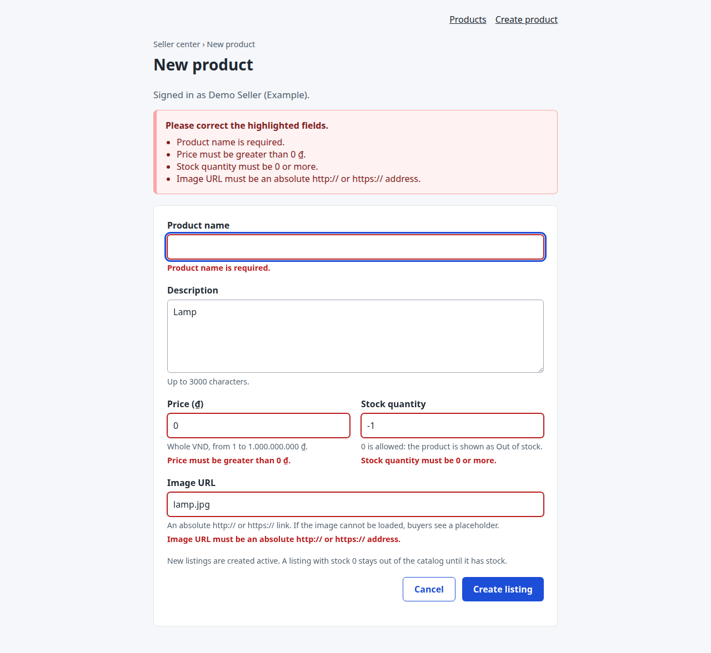
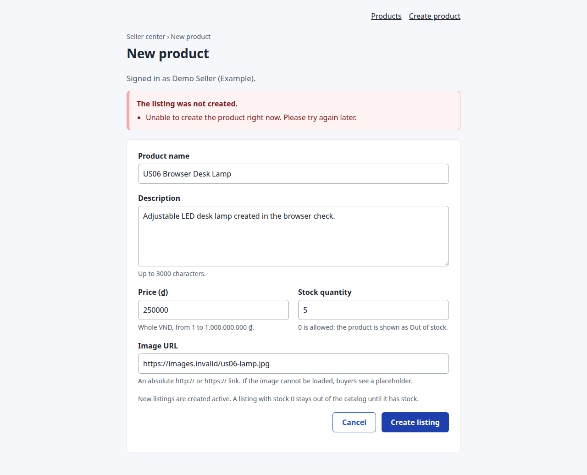
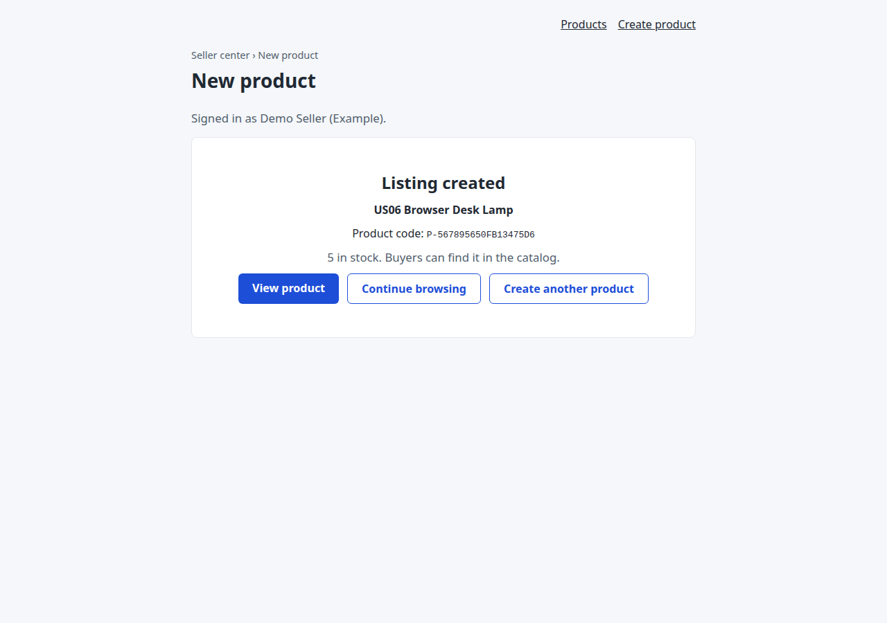
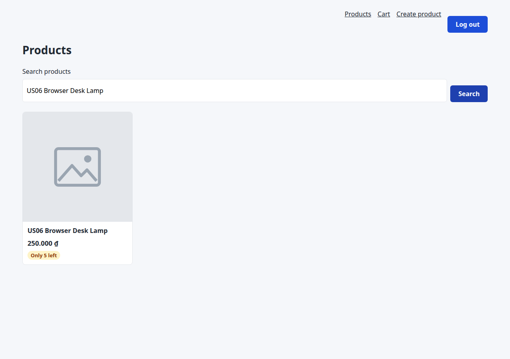
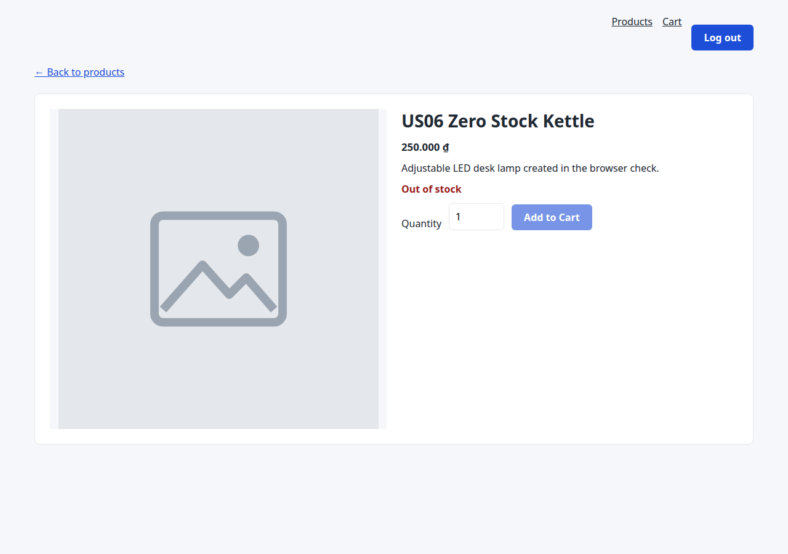
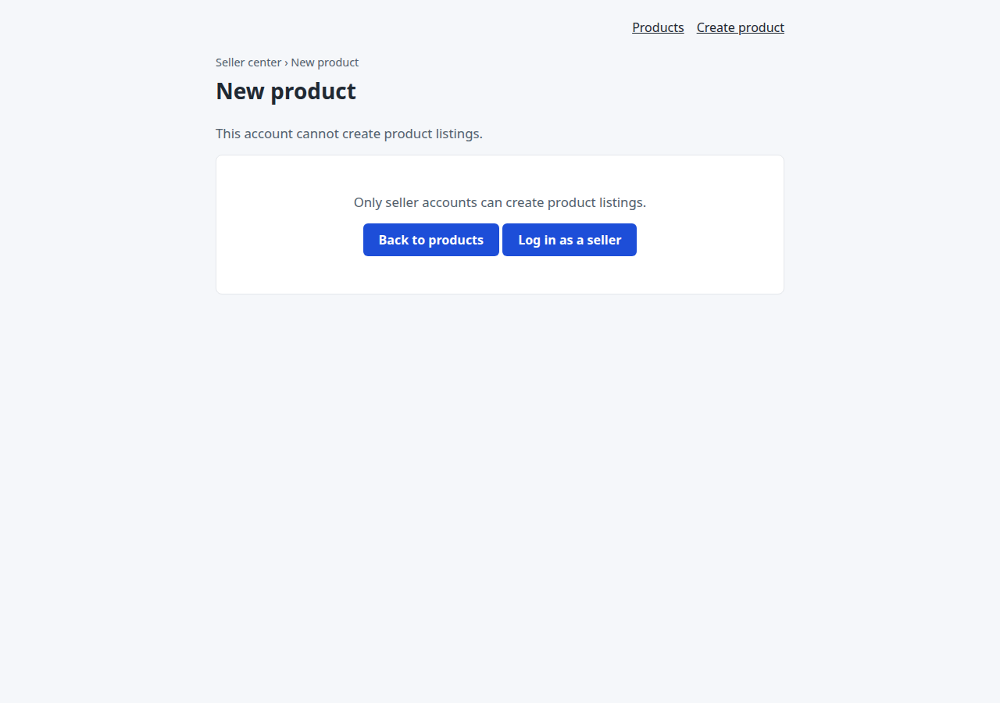
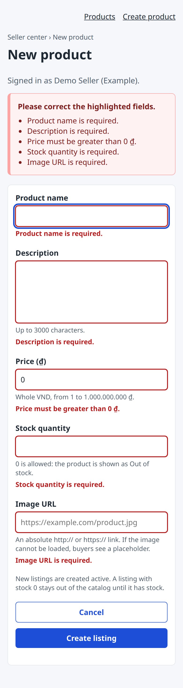

# US06 (#81) verification

Implementation branch: `feat/81-seller-product-creation`, based on `main` at
`859e6f0` (after PR #94, which closed #80).

## Automated checks

Run from the repository root in the project environment (Python 3.12):

```bash
DEBUG=false python -m pytest
python -m ruff check src tests
node tests/checkout_ui.mjs
node tests/seller_products_ui.mjs
git diff --check
```

On PowerShell set `$env:DEBUG = 'false'` first. The host had a `DEBUG` value that
Pydantic rejects, so the checks set it only for the command process; no `.env` was
changed.

| Check | Baseline on `main` | This branch |
|---|---|---|
| pytest | 219 passed | 297 passed (78 in `tests/test_seller_products.py`) |
| Ruff | All checks passed | All checks passed |
| `node tests/checkout_ui.mjs` | Passed | Passed |
| `node tests/seller_products_ui.mjs` | Not present | Passed |

One existing Starlette/httpx deprecation warning remains.

`tests/test_seller_products.py` uses a disposable SQLite file per test (the
`tests/cart_db.py` pattern) with a second seller, overrides `get_session` for the
API, and reads committed rows through a new session. It covers ownership and
server-owned fields; guest, malformed, expired, deleted-user and buyer tokens; every
field rule with its message (missing, null, wrong type, whitespace only, too long,
zero, negative, fractions, booleans, numeric strings, too large, bad URL schemes,
relative paths, spaces, invalid ports); boundary values; several invalid fields at
once; malformed JSON and non-object bodies; no echo of submitted values; an
unreachable image URL stored without any network access; code format, forced
collision with retry, collision exhaustion (`409`, no row), concurrent creations on
separate connections; failure before commit (rollback, session still usable), a
`500` without SQL details, and constraint failures that are not code collisions.
Integration tests create listings through the API and check catalog search,
pagination beyond page 1, the detail API and page, the cart, and checkout: the
seller order belongs to the creating seller, the order item keeps the purchase
price, and stock and version change as expected. A zero-stock listing has a detail
page with `out_of_stock`, is absent from the catalog, and cannot be added to a cart.
Validation responses of cart, checkout, catalog and login are unchanged.

`tests/seller_products_ui.mjs` runs the real `seller-product-new.js` against DOM and
network test doubles, in which any use of `innerHTML` fails the run. It checks guest
and rejected-token redirects, the buyer forbidden state, account-check retry, client
validation without a POST, the request body and token, field mapping of a server
`422`, summary-only `_form`, `403`, `409`, `500`, `502` and network errors with
values kept and no automatic resend, the pending lock against double submit, the
session-expiry draft restored only for the same seller, the success region (code,
name, encoded link, text rendering, zero-stock note), and account switches before
submit, during the POST, during the account check and in another tab. It also runs
the existing `products.js` and `product-detail.js` with a new listing whose image URL
fails: both fall back to `/static/product-placeholder.svg`, and the detail page shows
"Out of stock" with Add to Cart disabled. Eight deliberate defects in the form script
(removed guards, `innerHTML`, unencoded link, `parseInt`-style parsing, UTF-16
length, unscoped draft, no focus) were each caught by this script before it was
committed.

CI now sets up Node in the Python job and runs both page-script checks; the Node job
in `ci.yml` only runs when a `package.json` exists, which this project does not have.

## Browser checks

Run on 2026-10-17 in headless Chromium (Playwright 1.61) against
`uvicorn src.main:app` on a freshly seeded temporary SQLite database. 30 of 30 checks
passed, with no page script errors. The server log shows exactly three create
requests reaching the server (one `422`, two `201`); the `500` and network failure
below were simulated in the browser with request interception.

| Step | Result |
|---|---|
| Guest clicks **Create product** in the catalog | Sent to `/login?return_to=%2Fseller%2Fproducts%2Fnew`; after logging in as `seller@example.com` the form opens |
| Keyboard | Tab order: name, description, price, stock, image URL, Cancel, Create listing |
| Empty name, price 0, stock -1, image `lamp.jpg` | Errors beside each field and in the summary; focus on Product name; `aria-invalid` set; no request sent; values kept |
| Image `https://example.com:0/lamp.jpg` (passes the browser URL parser) | Real server `422`; message beside Image URL; values kept |
| Simulated `500 ERR_DATABASE_FAILURE` | Summary "The listing was not created."; no field marked; values kept; button enabled |
| Simulated network failure | "The listing was not confirmed."; exactly one request, no automatic resend |
| Valid listing, stock 5, unreachable image URL | Success region with name and code; **View product** opens `/products/{code}` with the placeholder image; catalog search finds the card with the placeholder |
| Listing with stock 0 | Success note explains Out of stock; detail shows "Out of stock" with Add to Cart disabled; catalog search and API list are empty |
| Buyer logs in in another tab before submit | Form hidden, no request sent, **Reload page** offered |
| Buyer opens the form | Forbidden message; form not shown |
| Buyer buys 2 of the new listing | Checkout succeeds; available stock goes from 5 to 3 |
| Mobile 390 x 844 | One-column form, no horizontal overflow |















## Manual review path

1. `python -m src.seed`, then `python -m src.main`.
2. Open `/products`, choose **Create product**, log in as `seller@example.com` /
   `password`.
3. Submit an empty form, then invalid values; check the messages and that values stay.
4. Create a listing with stock above 0 and an image URL that does not load. Check the
   code and name, **View product**, the placeholder image, and catalog search.
5. Create a listing with stock 0: the product page shows Out of stock and catalog
   search does not find it.
6. Log in as `user@example.com` / `password`: `/seller/products/new` is forbidden;
   buy the listing from step 4.

Not claimed: screen-reader testing, other browsers, and real-user usability (#83).
Review approval and merge remain PR steps.
