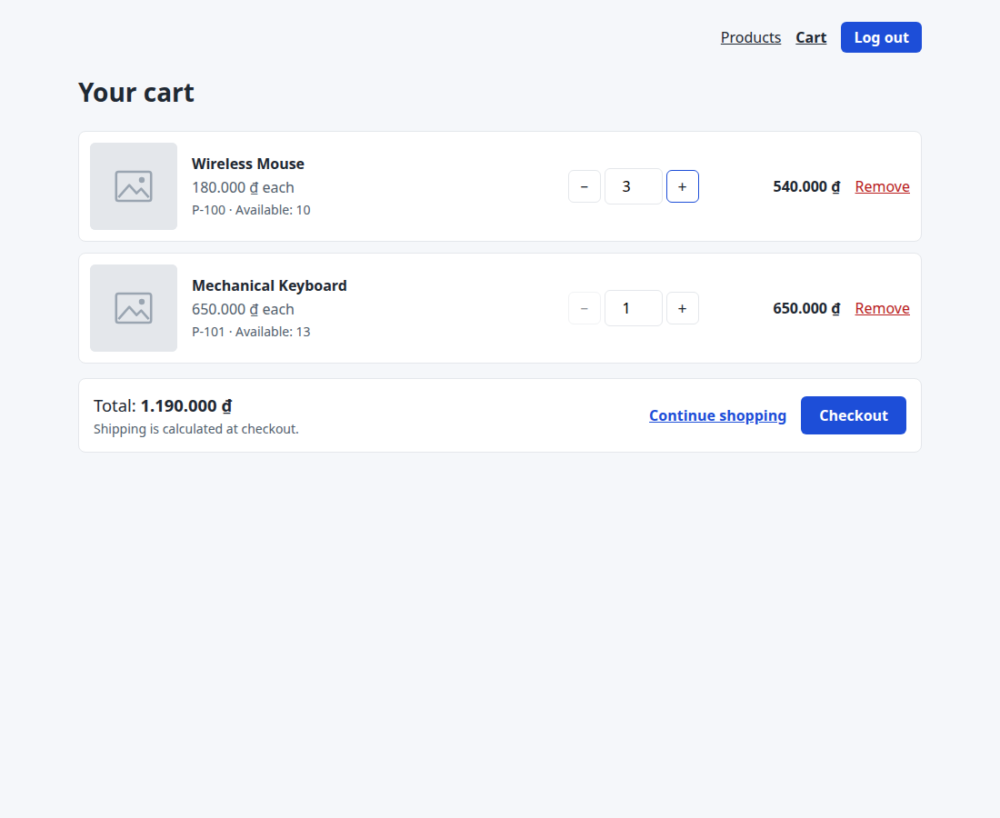
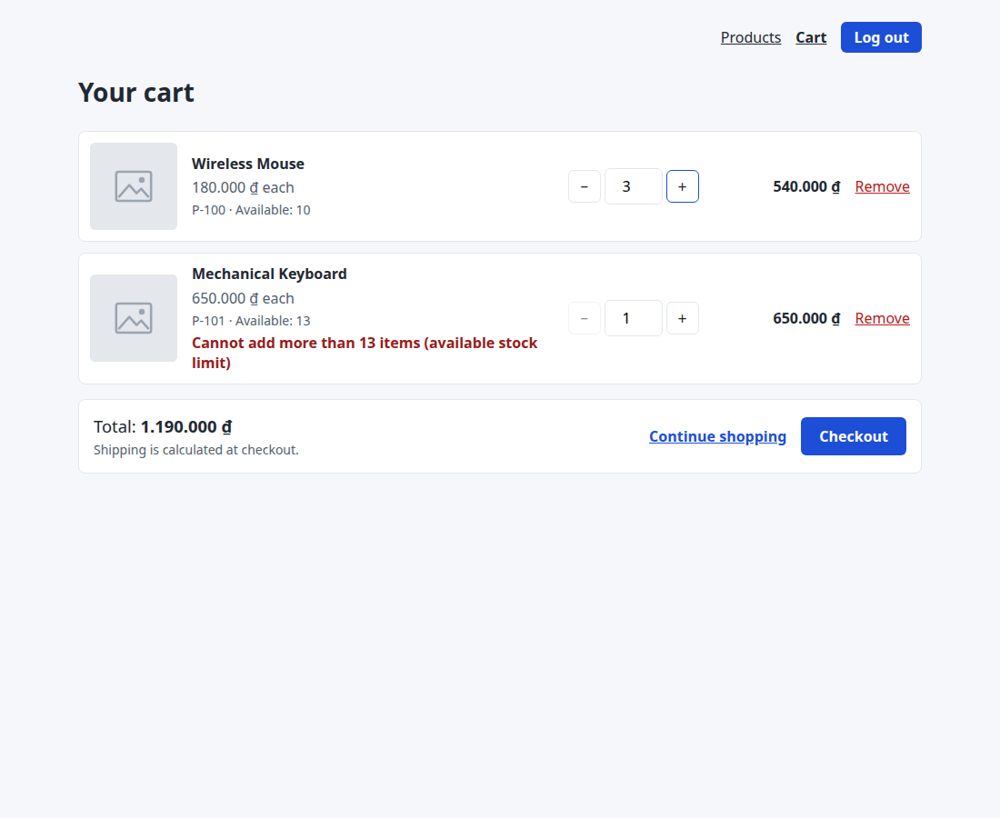
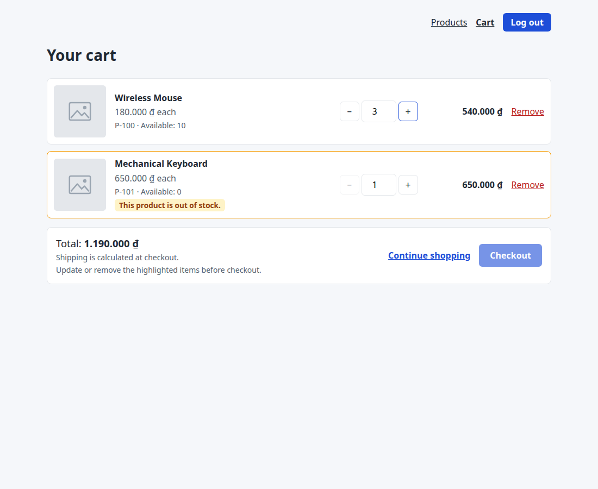
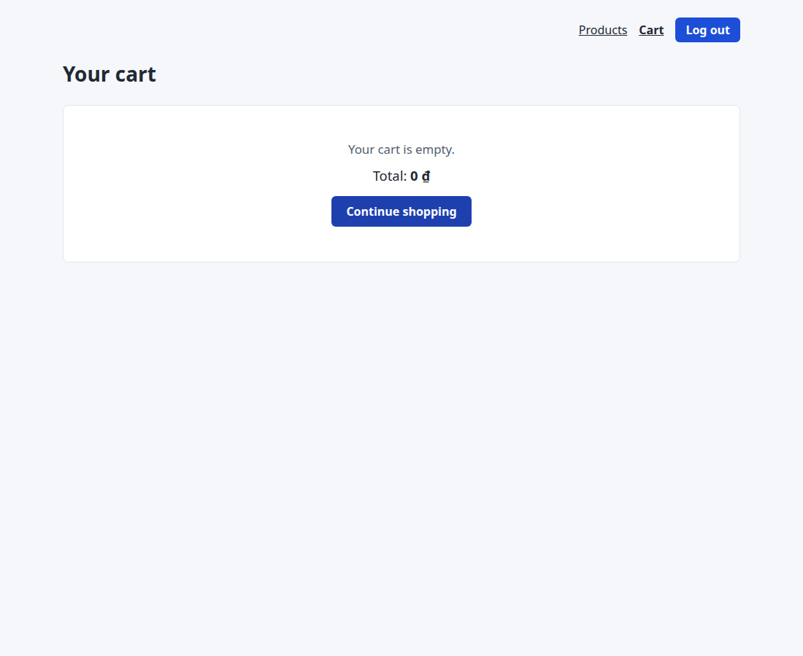
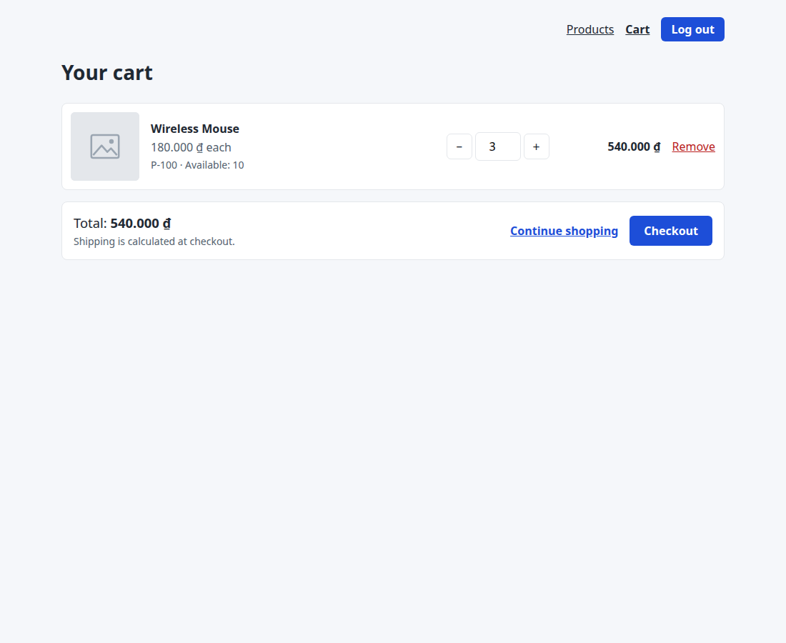

# Traceability

Every screen traces back to a feature and forward to the issue that built it.

This table is the single source of truth for Milestone 1 section 6 and for the
Milestone 4 report. Keep it current - a PR that adds a route and does not
update this file should not be approved.

| Route | Purpose | Access | Priority | Feature | Story issue | Spec PR (Milestone 1) | Implementation PR (Sprint 2 and 3) | Runtime |
|---|---|---|---|---|---|---|---|---|
| `/products` | Browse product catalog | G | P0 | F1 Product Discovery | [#13](https://github.com/SE-FDA-NEU/G1_AI66A_SE/issues/13), [#45](https://github.com/SE-FDA-NEU/G1_AI66A_SE/issues/45), [#77](https://github.com/SE-FDA-NEU/G1_AI66A_SE/issues/77) | [#24](https://github.com/SE-FDA-NEU/G1_AI66A_SE/pull/24) | [#57](https://github.com/SE-FDA-NEU/G1_AI66A_SE/pull/57), [#58](https://github.com/SE-FDA-NEU/G1_AI66A_SE/pull/58), [#59](https://github.com/SE-FDA-NEU/G1_AI66A_SE/pull/59), [#60](https://github.com/SE-FDA-NEU/G1_AI66A_SE/pull/60), [#61](https://github.com/SE-FDA-NEU/G1_AI66A_SE/pull/61), [#64](https://github.com/SE-FDA-NEU/G1_AI66A_SE/pull/64), [#65](https://github.com/SE-FDA-NEU/G1_AI66A_SE/pull/65), [#68](https://github.com/SE-FDA-NEU/G1_AI66A_SE/pull/68), [#70](https://github.com/SE-FDA-NEU/G1_AI66A_SE/pull/70), [#90](https://github.com/SE-FDA-NEU/G1_AI66A_SE/pull/90) | Implemented: search, pagination, stock filter (BR1) |
| `/products/:productCode` | View product details and reviews | G/U | P0 / P1 | F1 Product Discovery | [#14](https://github.com/SE-FDA-NEU/G1_AI66A_SE/issues/14), [#78](https://github.com/SE-FDA-NEU/G1_AI66A_SE/issues/78), [#107](https://github.com/SE-FDA-NEU/G1_AI66A_SE/issues/107) | [#35](https://github.com/SE-FDA-NEU/G1_AI66A_SE/pull/35) | [#91](https://github.com/SE-FDA-NEU/G1_AI66A_SE/pull/91) | Product detail implemented; US15 verified reviews and seller replies in current branch, pending PR |
| `/cart` | Manage shopping cart | U | P0 | F2 Cart | [#15](https://github.com/SE-FDA-NEU/G1_AI66A_SE/issues/15), [#79](https://github.com/SE-FDA-NEU/G1_AI66A_SE/issues/79) | [#31](https://github.com/SE-FDA-NEU/G1_AI66A_SE/pull/31) | [#92](https://github.com/SE-FDA-NEU/G1_AI66A_SE/pull/92) | Implemented: four states, quantity changes, stock flags (BR2) |
| `/checkout` | Place an order | U | P0 | F3 Ordering | [#16](https://github.com/SE-FDA-NEU/G1_AI66A_SE/issues/16), [#80](https://github.com/SE-FDA-NEU/G1_AI66A_SE/issues/80) | [#23](https://github.com/SE-FDA-NEU/G1_AI66A_SE/pull/23) | [#94](https://github.com/SE-FDA-NEU/G1_AI66A_SE/pull/94) | Implemented: atomic, idempotent checkout; confirmation at `/checkout/confirmation/:orderId` |
| `/orders` | View buyer orders | U | P1 | F3 Ordering | [#17](https://github.com/SE-FDA-NEU/G1_AI66A_SE/issues/17) | [#27](https://github.com/SE-FDA-NEU/G1_AI66A_SE/pull/27) | None yet | Not implemented |
| `/orders/:id` | View buyer order details | U | P1 | F3 Ordering | [#17](https://github.com/SE-FDA-NEU/G1_AI66A_SE/issues/17) | [#27](https://github.com/SE-FDA-NEU/G1_AI66A_SE/pull/27) | None yet | Not implemented |
| `/seller/products` | Manage seller products | U | P0 | F4 Product Management | None | None | None yet | Not implemented; not in the Milestone 1 requirements (gap G8) |
| `/seller/products/new` | Create product listing | U | P0 | F4 Product Management | [#18](https://github.com/SE-FDA-NEU/G1_AI66A_SE/issues/18), [#81](https://github.com/SE-FDA-NEU/G1_AI66A_SE/issues/81) | [#32](https://github.com/SE-FDA-NEU/G1_AI66A_SE/pull/32) | [#95](https://github.com/SE-FDA-NEU/G1_AI66A_SE/pull/95) | Implemented: field-level errors, owner from token (BR5, BR9) |
| `/seller/products/:productId/edit` | Update product information and stock | U | P1 | F4 Product Management | [#19](https://github.com/SE-FDA-NEU/G1_AI66A_SE/issues/19) | [#34](https://github.com/SE-FDA-NEU/G1_AI66A_SE/pull/34) | None yet | Not implemented |
| `/seller/orders` | Manage incoming orders | U | P0 | F5 Order Management | [#20](https://github.com/SE-FDA-NEU/G1_AI66A_SE/issues/20), [#82](https://github.com/SE-FDA-NEU/G1_AI66A_SE/issues/82), [#106](https://github.com/SE-FDA-NEU/G1_AI66A_SE/issues/106) | [#26](https://github.com/SE-FDA-NEU/G1_AI66A_SE/pull/26) | [#96](https://github.com/SE-FDA-NEU/G1_AI66A_SE/pull/96) | US14 transitions and order UI provide the status events used by US15 notifications |
| `/notifications` | View and mark in-app notifications | U | P1 | F1 Product Discovery / F3 Ordering | [#107](https://github.com/SE-FDA-NEU/G1_AI66A_SE/issues/107) | None | Pending PR | Implemented in current branch; buyer, seller, read state and event links |
| `/seller/analytics` | View sales analytics | U | P1 | F6 Analytics | [#21](https://github.com/SE-FDA-NEU/G1_AI66A_SE/issues/21) | [#33](https://github.com/SE-FDA-NEU/G1_AI66A_SE/pull/33) | None yet | Not implemented |
| `/seller/analytics/products` | View best-selling product ranking | U | P2 | F6 Analytics | [#22](https://github.com/SE-FDA-NEU/G1_AI66A_SE/issues/22) | [#39](https://github.com/SE-FDA-NEU/G1_AI66A_SE/pull/39) | None yet | Not implemented |

**Access codes:** G = guest (not logged in) · U = authenticated user · A = admin

**Spec PR:** the merged Milestone 1 pull request that specified the story. A
merged spec PR means the story is specified, not built.

**Runtime** on `main` at `932f480` (after PR #96), updated in #85: Implemented /
Partial / Not implemented. All six P0 screens are implemented. The login page
(`/login`, #75, PR #89) and the browser entry at `/` (#83, PR #97) are shared
screens, not story screens; see [docs/ui.md](ui.md#1-p0-stories-and-status).

## P0 story map

Each P0 story traced from the Milestone 1 requirements through the screen, the
endpoint in the [API design](design.md#33-p0-endpoint-contract) and the tables
in the [data model](design.md#22-table-definitions) to what runs on `main` at
`932f480`. All six stories are implemented and merged in Sprint 3. Cross-story
flows are tested in `tests/test_p0_flows.py` (#83, PR #97), and screenshots
of every screen and state are in the [Milestone 3 evidence](evidence/milestone3.md).

| Story | Screen | Endpoint | Tables | Runtime on `main` | Tests and evidence |
|---|---|---|---|---|---|
| [US01](us01-browse-product-catalog.md) Browse product catalog ([#13](https://github.com/SE-FDA-NEU/G1_AI66A_SE/issues/13)) | `/products` | `GET /api/v1/products` | `products`; `users` as the owning seller | Implemented ([#77](https://github.com/SE-FDA-NEU/G1_AI66A_SE/issues/77), [#90](https://github.com/SE-FDA-NEU/G1_AI66A_SE/pull/90)): search, 20 per page with page controls, only active products with available stock | `tests/test_products.py`, `tests/test_products_page.py`, `tests/test_issue45_scenarios.py`; evidence M3-01 to M3-05 |
| [US02](us02-view-product-detail.md) View product details ([#14](https://github.com/SE-FDA-NEU/G1_AI66A_SE/issues/14)) | `/products/:productCode` | `GET /api/v1/products/{productCode}` | `products` | Implemented ([#78](https://github.com/SE-FDA-NEU/G1_AI66A_SE/issues/78), [#91](https://github.com/SE-FDA-NEU/G1_AI66A_SE/pull/91)): detail by public code, Out of stock state, Add to Cart with login return | `tests/test_product_detail.py`; evidence M3-06 to M3-10 |
| [US03](us03-cart.md) Cart management ([#15](https://github.com/SE-FDA-NEU/G1_AI66A_SE/issues/15)) | `/cart` | `GET /api/v1/cart`; `POST /api/v1/cart/items`; `PATCH` and `DELETE /api/v1/cart/items/{productCode}` | `cart_items`, `products`, `users` | Implemented ([#79](https://github.com/SE-FDA-NEU/G1_AI66A_SE/issues/79), [#92](https://github.com/SE-FDA-NEU/G1_AI66A_SE/pull/92)) for authenticated buyers, with the four required states | `tests/test_cart_service.py`, `tests/test_cart_api.py`, `tests/test_cart_page.py`; [evidence for issue #79](#evidence-for-issue-79); M3-12 to M3-15, M3-19, M3-28 |
| [US04](us04-checkout.md) Checkout and order placement ([#16](https://github.com/SE-FDA-NEU/G1_AI66A_SE/issues/16)) | `/checkout`, `/checkout/confirmation/:orderId` | `POST /api/v1/orders` | `orders`, `seller_orders`, `order_items`, `cart_items`, `products`, `users` | Implemented ([#80](https://github.com/SE-FDA-NEU/G1_AI66A_SE/issues/80), [#94](https://github.com/SE-FDA-NEU/G1_AI66A_SE/pull/94)): one transaction, Idempotency-Key replay, buyer-owned receipt | `tests/test_checkout.py`, `tests/checkout_ui.mjs`; [US04 evidence](evidence/us04.md); M3-16, M3-17, M3-20 |
| [US06](us06-create-product.md) Create product listing ([#18](https://github.com/SE-FDA-NEU/G1_AI66A_SE/issues/18), [#81](https://github.com/SE-FDA-NEU/G1_AI66A_SE/issues/81)) | `/seller/products/new` | `POST /api/v1/seller/products` | `products`, `users` | Implemented ([#81](https://github.com/SE-FDA-NEU/G1_AI66A_SE/issues/81), [#95](https://github.com/SE-FDA-NEU/G1_AI66A_SE/pull/95)) for authenticated sellers | `tests/test_seller_products.py`, `tests/seller_products_ui.mjs`; [US06 evidence](evidence/us06.md); M3-21 to M3-23 |
| [US08](us08-seller-order-management.md) Seller order management ([#20](https://github.com/SE-FDA-NEU/G1_AI66A_SE/issues/20)) | `/seller/orders` | `GET /api/v1/seller/orders`; `PATCH /api/v1/seller/orders/{subOrderId}/status` | `seller_orders`, `order_items`, `orders`, `products`, `users` | Implemented ([#82](https://github.com/SE-FDA-NEU/G1_AI66A_SE/issues/82), [#96](https://github.com/SE-FDA-NEU/G1_AI66A_SE/pull/96)): seller-scoped list with filters, transitions with `order_history`, cancellation restock | `tests/test_seller_orders.py`, `tests/seller_orders_ui.mjs`; M3-11, M3-18, M3-24 to M3-27 |

Every P0 route of the [API design](design.md#33-p0-endpoint-contract) runs on `main`
at `932f480`, together with `/login`, `/api/v1/auth/login`, `/api/v1/auth/me`, `/health`
and `GET /`.

## Task 3: Database-backed product API

`GET /api/v1/products?page={page}&limit={limit}` is implemented by
`src/api/products.py:list_products()`. It queries the `products` table
(`src/models/product.py`) through the SQLModel session injected as `SessionDep`
(`src/database.py`), returns only active products, and orders them by `id` so
pages are stable. `python -m src.database` creates the table and
`python -m src.seed` loads 45 sample products; running the seed again adds none.

Equivalent SQL for one request:

```sql
SELECT COUNT(*) FROM products WHERE is_active = TRUE;

SELECT * FROM products
WHERE is_active = TRUE
ORDER BY id
LIMIT :limit OFFSET :offset;   -- offset = (page - 1) * limit
```

The internal primary key `id` is an integer; the API returns it as a string,
together with the product `code` (for example `P-100`). `thumbnail_url` and
`image_url` both come from the `image_url` column, and `stock_status` is derived
from `stock_quantity`: `out_of_stock` at 0, `low_stock` up to 5, otherwise
`in_stock`.

| Task 3 requirement | Implementation | Status |
|---|---|---|
| Fetch products from the real database | `list_products()` runs SQLModel `select` queries through `SessionDep` | Done |
| Do not hard-code the product list | Every item in `data` is built from a selected `Product` row | Done |
| Support the defined product-list API contract | Returns `data` and `meta` (`current_page`, `limit`, `total`, `total_pages`); `page < 1`, `limit < 1` or `limit > 100` return `422` | Done |
| Apply catalog visibility rules | Both queries filter on `is_active = TRUE` | Done |
| Keep query failures apart from an empty catalog | A database error is logged on the server and returns `500` with a generic message; an empty table returns `200` with `data: []` and `total: 0` | Done |

### Backend evidence for issue #49

Run on 2026-10-04 against commit `489f187` with a new SQLite database file.
Environment: Ubuntu 24.04 on WSL2, Python 3.12.3, FastAPI 0.142.2,
SQLModel 0.0.22, SQLAlchemy 2.0.54, Uvicorn 0.54.0.

```text
$ python -m src.database
Database initialization completed successfully.
$ python -m src.seed
Added: 45 products
Total products: 45
Active products: 45
$ python -m src.seed
Added: 0 products
Total products: 45
Active products: 45
$ python -m uvicorn src.main:app --host 127.0.0.1 --port 8000
$ curl "http://127.0.0.1:8000/api/v1/products?page=1&limit=20"
```

First item and `meta` of that response:

```json
{"id": "1", "code": "P-100", "name": "Wireless Mouse", "description": "Wireless mouse for study and office work", "price": 180000.0, "thumbnail_url": "/images/p-100.jpg", "image_url": "/images/p-100.jpg", "stock_quantity": 12, "stock_status": "in_stock"}
{"current_page": 1, "limit": 20, "total": 45, "total_pages": 3}
```

| Check | Result |
|---|---|
| Pages 1 to 4 with `limit=20` | 20, 20, 5 and 0 items; 45 distinct codes; `total` 45 and `total_pages` 3 on every page |
| `page=0`, `limit=0`, `limit=101` | `422` |
| `P-100` set to `is_active = 0` | Not in `data`; `total` drops to 44 |
| Name and price of `P-101` changed in the database | The next response shows the new values |
| `products` table renamed, so the query fails | `500` with `{"detail": "Unable to load products right now. Please try again later."}`; the server log shows `Product catalog query failed` with the traceback |
| All rows deleted | `200` with `data: []`, `total: 0`, `total_pages: 0` |

The `/products` browser checks from the frontend evidence below were rerun on
this commit and database (20/20 passed). Screenshots:
[catalog](images/issue49-catalog.png),
[empty state](images/issue49-empty-state.png),
[error with Retry](images/issue49-error-retry.png).
Automated coverage is in `tests/test_products.py` and `tests/test_database.py`
(`pytest`: 22 passed).

## Frontend `/products` evidence

The guest-facing `/products` page is served by the same FastAPI app as the API:
`src/web/router.py` returns `src/web/pages/products.html`, and `src/main.py`
mounts `src/web/static/` at `/static`. Browser behavior lives in
`src/web/static/products.js`, which requests `/api/v1/products?page=1&limit=20`
and renders only `response.data`; it does not contain a hard-coded product
array. The page renders product cards, a loading skeleton, an API error with a
Retry action, and the empty-state message `No products available at the moment.`

| Frontend requirement | Implementation | Evidence |
|---|---|---|
| Display products returned by the backend | `loadProducts()` in `src/web/static/products.js` fetches the first page and builds each card with `createProductCard()` | Browser page at `http://127.0.0.1:8000/products` |
| Display at least 10 records when available | The request asks for `page=1&limit=20`, so the page shows up to 20 products | With the 45 seeded products, the page shows 20 of 45 |
| Display an empty state | `loadProducts()` shows the empty state when `data` is empty and `meta.total` is 0 | An empty `products` table shows the empty-state message |
| Handle loading and API failures | `loadProducts()` shows a loading skeleton; HTTP errors, network failures, a 10 s timeout and malformed payloads show an error with a Retry button | An API `500` shows the error state; Retry reloads the products |

### Evidence for issue #49

Captured on 2026-10-04 against commit `883e9a4` (PR #61), using a new SQLite
database file seeded with `python -m src.seed` (45 active products).
Environment: Ubuntu 24.04 on WSL2, Python 3.12.3, FastAPI 0.142.2,
SQLModel 0.0.22, SQLAlchemy 2.0.54, Uvicorn 0.54.0, headless Chromium 149
driven by Playwright.

| Check | Result |
|---|---|
| Clean seeded database | `GET /api/v1/products?page=1&limit=20` returns `meta.total` 45 and 20 items; the page shows the same 20 names and prices, formatted in VND (`180.000 ₫`) |
| Name and price changed in the test database, page reloaded | The first card shows the new name and price |
| Empty test database (`DELETE FROM products`) | API `200` with `data: []` and `total: 0`; the page shows the empty state without errors |
| API error (`products` table renamed in the test database) | API `500`; the page shows the error message and Retry; after the table is restored, Retry shows the 20 products again |
| Layout at 1280 / 800 / 390 px | 4 / 3 / 2 columns, no horizontal scrolling |


To reproduce:

```bash
python3 -m venv .venv
source .venv/bin/activate
pip install -r requirements.txt
cp .env.example .env    # keep only DATABASE_URL=sqlite:///./marketplace.db
python -m src.seed      # creates the tables, a demo seller and 45 products; a rerun adds none
python -m uvicorn src.main:app --host 127.0.0.1 --port 8000
```

Open http://127.0.0.1:8000/products. Run the edit, empty and error checks on a
disposable copy of the database.

## Frontend `/cart` evidence

The buyer's cart page is served at `/cart` by `src/web/router.py`. Its script,
`src/web/static/cart.js`, sends the token saved by the login page as
`Authorization: Bearer`, renders only the cart returned by `/api/v1/cart`, and
re-renders after each change from the server's answer. The page follows the
wireframe in [`docs/ui.md`](ui.md) section 2.3.

| Acceptance criterion (#79) | Implementation | Automated test |
|---|---|---|
| An added product is stored in the database with its quantity | Add to Cart on `/products/:productCode` (#78) calls `POST /api/v1/cart/items`, which runs `CartService.add_item()` | `test_first_add_stores_one_line`, `test_add_creates_a_line_then_increases_it`, `test_buyer_can_add_product_to_database_backed_cart` |
| Adding the same product again increases the existing line | `add_item()` increases the line found by `buyer_id` and `product_id` in one `UPDATE`, so concurrent additions are all kept | `test_adding_the_same_product_again_increases_the_existing_line`, `test_add_does_not_overwrite_an_increase_made_after_reading_the_line`, `test_concurrent_cart_additions_preserve_all_updates`, `test_concurrent_cart_inserts_handle_conflict_gracefully`, `test_database_allows_one_line_per_buyer_and_product` |
| Quantity 2 changed to 3 is still correct after a reload | `PATCH /api/v1/cart/items/{productCode}`; the page reloads from `GET /api/v1/cart` | `test_quantity_change_survives_a_reload_with_recalculated_total`, `test_quantity_change_survives_a_reload` |
| Removing a line recalculates the total | `DELETE /api/v1/cart/items/{productCode}` returns the remaining cart | `test_removing_a_line_keeps_the_others_and_recalculates_the_total`, `test_delete_removes_the_line_and_recalculates_the_total` |
| A quantity above available stock is refused and the previous one kept | `validate_purchasable_quantity()`; the page puts the previous quantity back and shows the server's message next to the line | `test_update_above_available_stock_keeps_the_previous_quantity`, `test_quantity_above_stock_is_refused_and_the_previous_one_kept`, `test_add_refuses_one_more_than_the_available_stock`, `test_update_refuses_one_more_than_the_available_stock`, `test_a_change_that_fails_after_writing_is_rolled_back`, `test_database_failure_after_writing_leaves_the_cart_unchanged` |
| An empty cart shows the empty state with Continue shopping | `GET` returns `200` with `items: []`; the page shows `Your cart is empty.`, total `0 ₫` and a link to `/products` | `test_buyer_without_lines_gets_an_empty_cart` (service and API), `test_cart_page_offers_empty_error_and_checkout_actions` |

### Evidence for issue #79

Captured on 2026-10-14 against commit `a4aaec4` on `feat/79-cart`, using a new
SQLite database file seeded with `python -m src.seed` and the seeded buyer
`user@example.com`. Environment: Ubuntu 24.04 on WSL2, Python 3.12.3,
FastAPI 0.142.2, SQLModel 0.0.22, SQLAlchemy 2.0.54, Uvicorn 0.54.0, headless
Chromium 149 driven by Playwright. Items were added with
`POST /api/v1/cart/items`, before the Add to Cart button of #78 was merged.

| Check | Result |
|---|---|
| Guest opens `/cart` | Sent to `/login?return_to=%2Fcart`; after logging in, the buyer is back on `/cart` and sees the empty state with total `0 ₫` |
| Add `P-100` twice with quantity 1 | `201`, then `200`; `cart_items` holds one `P-100` line with quantity 2 |
| `+` on `P-100`, then reload | Quantity 3 and total `1.190.000 ₫` (3 × 180.000 + 650.000) on screen and in `cart_items` |
| Type 99 for `P-101` (13 available) | `Cannot add more than 13 items (available stock limit)` next to the line; the field returns to 1; the database and the total are unchanged |
| Type 0 | `Enter a whole number of at least 1.` without a request; `−` is disabled at quantity 1 |
| Stock of `P-101` set to 0 in the database, page reloaded | The line stays with its quantity, shows `This product is out of stock.`, and Checkout is disabled until the line is removed |
| Remove the last line | Empty state; `cart_items` is empty |
| Seller `seller@example.com` opens `/cart` | `A buyer account is required.` without Retry |
| Tampered token in `localStorage` | Token removed, sent to `/login?return_to=%2Fcart` |
| Width 375 px | No horizontal scrolling |









#### Add to Cart from the product detail page (#78)

Captured on 2026-10-16 against the merge commit `d9f956e`, after #78
([PR #91](https://github.com/SE-FDA-NEU/G1_AI66A_SE/pull/91)) reached `main`, on a new seeded database in the same environment.

| Check | Result |
|---|---|
| Guest opens `Wireless Mouse` from the catalog, sets quantity 2, selects Add to Cart | Sent to `/login?return_to=/products/P-100?quantity=2`; nothing is added yet |
| Buyer logs in | Back on `/products/P-100` with quantity 2 kept; Add to Cart opens `/cart` with one `P-100` line of 2, and `cart_items` holds the same |
| Add `P-100` again with quantity 1 | Still one line, now 3; total `540.000 ₫` |
| Add 8 more from the detail page (10 available, 3 in the cart) | The detail page shows `Cannot add more than 10 items (available stock limit)` and stays open; the cart keeps 3 |
| Product with no available stock | `Out of stock` and Add to Cart disabled |
| Cart link in the detail page navigation | Opens `/cart` |



To reproduce, seed a new database as in the `/products` evidence above, start
the app, open http://127.0.0.1:8000/products, choose a product, select Add to
Cart and log in as `user@example.com` with password `password`.

## REST API design

The complete API contract is documented in
[`docs/design.md`](./design.md). It defines the method, path, access
requirement, inputs, success response, and error responses for the P0
product, cart, checkout, seller product, and seller order workflows.

| Design deliverable | Coverage | Status |
|---|---|---|
| REST endpoint contract | 13 documented endpoints under `/api/v1`, updated to the running behaviour in #85 | Done |
| Error handling contract | Every error code the API raises, with its status and trigger (design.md section 3.4); checked by `tests/test_ui_docs_contract.py` | Done |
| P0 story coverage | US01, US02, US03, US04, US06, and US08 mapped to endpoints | Done |

## P0 UI wireframes and documentation

The UI documentation is [`docs/ui.md`](./ui.md), in the four sections Milestone 3
asks for. It started as the wireframes of #76 (PR #88) and was finalized against the
running screens in #85. `tests/test_ui_docs_contract.py` checks its structure and
content against the code.

| Milestone 3 requirement | Where in `docs/ui.md` | Traceability |
|---|---|---|
| P0 stories with screen, route, status and issue | Section 1, status table (all six "works") | US01, US02, US03, US04, US06, US08 |
| Where each story starts without typing a URL | Section 1, "Where each story starts"; README first screen | `tests/test_navigation.py` |
| Updated screen flow from M1 | Section 1, `images/ui/screen-flow.png` (source `screen-flow.mmd`) | Changes from the M1 diagram listed below it |
| One wireframe per P0 screen with purpose and API endpoints | Sections 2.1 to 2.7, plus login in 2.8 | US01 to US08 / issues #13 to #20 |
| One screen in all four states | Section 2.3, cart: empty, loading, error, data | US03 / #79 |
| At least four error messages with code and business rule | Section 3, 16 messages | Checked by `tests/test_ui_docs_contract.py` |
| At least one change since M2 recorded in design.md | Section 4; design.md sections 3.3 and 6.4 | Receipt names products (#85), plus four earlier changes |
| Known limits | Section 1, "Known limits" (UI-G1, UI-G7, UI-G8) | Follow-ups for #86 or Sprint 4 |
| Screenshots | `docs/images/ui/`; browser record in [evidence/milestone3.md](evidence/milestone3.md) | 31 checks, M3-01 to M3-31 |

## Business rules

Numbered, so issues and tests can cite them.

| # | Rule | Enforced where (on `main` at `932f480`, updated in #85) | Tested by |
|---|------|----------------|-----------|
| BR1 | Only available products can be displayed in the product catalog. | `list_products()` in `src/api/products.py` returns only rows with `is_active = TRUE` and `stock_quantity > reserved_stock` (#77, PR #90); the detail page still opens an out-of-stock product and shows "Out of stock" (#78, PR #91). | `test_products_database_pagination_and_visibility` and `test_list_products_searches_available_product_names` in `tests/test_products.py`; `test_out_of_stock_product_remains_visible_but_unavailable`; `test_a_zero_stock_listing_has_a_detail_page_but_stays_out_of_the_catalog` |
| BR2 | Buyers may add or update cart items only when the requested quantity is a positive integer and does not exceed current available stock. Adding an item to the cart does not reserve stock. | `validate_quantity()` and `validate_purchasable_quantity()` in `src/services/cart.py` (#79): available stock is `stock_quantity - reserved_stock`, and `POST` checks the quantity after adding to an existing line. The cart never writes to `products`. Backed by CHECK `quantity > 0` and `UNIQUE(buyer_id, product_id)` on `cart_items` (#46). | `tests/test_cart_service.py` (`test_reserved_stock_is_not_available_to_the_cart`, `test_add_checks_stock_against_the_quantity_after_adding`, `test_cart_changes_never_touch_product_stock`, invalid quantities); `tests/test_cart_api.py` (`409`, `400` and `422` responses); `test_add_rechecks_stock_when_the_line_filled_up_after_reading`; the stock boundary tests (`test_add_accepts_exactly_the_available_stock`, `test_add_refuses_one_more_than_the_available_stock`, `test_adding_to_a_line_may_reach_exactly_the_available_stock`, `test_update_accepts_exactly_the_available_stock`, `test_quantity_at_the_stock_limit_is_accepted_and_one_more_is_refused`); and `test_concurrent_additions_respect_stock_limit` in `tests/test_product_detail.py` |
| BR3 | A buyer must be authenticated before placing an order. | `POST /api/v1/orders` depends on `BuyerUser` (`src/api/orders.py`, #80); `/checkout` sends a guest to `/login?return_to=%2Fcheckout`. | `test_auth_empty_cart_key_and_pages` in `tests/test_checkout.py` (401 for a guest, 403 for a seller) |
| BR4 | A buyer can view only their own orders. | `receipt()` in `src/services/orders.py` selects the order by id and buyer; another buyer's order answers `404 ERR_ORDER_NOT_FOUND` (#80). | `test_api_create_replay_and_ownership` in `tests/test_checkout.py` |
| BR5 | Sellers may create and manage only products belonging to their own store. Product ownership must be derived from the authenticated seller identity. | `create_product()` in `src/services/seller_products.py` takes the owner from `SellerUser`; `ProductCreate` refuses `seller_id` and other server-owned fields (#81, PR #95). | `test_the_owner_always_comes_from_the_token_never_the_body`, `test_each_seller_owns_the_listings_they_create` in `tests/test_seller_products.py` |
| BR6 | Sellers can view and manage incoming orders related to their products. | `list_seller_orders()` filters `seller_orders.seller_id` by the token's seller; a status change on another seller's sub-order answers `403 ERR_RESOURCE_OWNER` (#82, PR #96). | `test_seller_order_listing_is_scoped_to_authenticated_seller`, `test_other_seller_cannot_update_owned_order` in `tests/test_seller_orders.py`; `test_buyers_and_guests_cannot_use_seller_orders` in `tests/test_ui_docs_contract.py`; page checks in `tests/seller_orders_ui.mjs` |
| BR7 | Seller revenue is calculated only from the authenticated seller's order items in COMPLETED orders, using the item price recorded at purchase time. | Data only: checkout stores `order_items.unit_price` (#80) and completing a seller order sets `seller_orders.completed_at` (#82). Revenue analytics (US09, P1) is not built. | Inputs only: `test_multi_seller_checkout_and_price_snapshots`, `test_completion_sets_completed_at`; no revenue test |
| BR8 | Before creating an order, the system must revalidate product availability and stock using the latest stock data. If stock is insufficient, the order must not be created and the buyer must be informed which item caused the problem. | `checkout()` in `src/services/orders.py` rechecks every line in one transaction: active product, matching `version` and `stock_quantity - reserved_stock >= quantity`; any failure rolls everything back and names the item (#80, PR #94). | `test_invalid_second_item_rolls_back_everything`, `test_stale_product_version_aborts_checkout`, `test_concurrent_requests_on_separate_connections` in `tests/test_checkout.py` |
| BR9 | Product updates (price, stock quantity, and product information) must validate that price is strictly positive (> 0) and stock quantity is a non-negative integer (>= 0). If an update fails validation, the database transaction is aborted, and all previous valid data remains unchanged. | Product creation: `ProductCreate` (strict integers, price > 0, stock >= 0) and the CHECK constraints on `products`; a failed create writes nothing (#81, PR #95). The update flow (US07, P1) is not built. | `test_invalid_field_is_reported_beside_that_field_and_nothing_is_written`, `test_failure_before_commit_rolls_back_and_the_session_stays_usable` in `tests/test_seller_products.py` |
| BR10 | Seller best-selling product analytics must rank only the authenticated seller's own products using quantities from completed order items in the selected reporting period. | Design only: best-selling analytics (US10, P2) is not built. | None yet |


## US04 implementation update (#80)

This branch supersedes the historical Sprint 2 US04 "Not implemented" entries above.
Implementation branch: feat/80-atomic-checkout; baseline main includes cart PR #92.

| Screen / API | Access | Status |
|---|---|---|
| /checkout; POST /api/v1/orders | Buyer | Merged in PR #94 |
| /checkout/confirmation/{orderId}; GET /api/v1/orders/{orderId} | Owning buyer | Merged in PR #94 |

| Requirement / business rule | Automated verification in tests/test_checkout.py |
|---|---|
| Valid multi-seller checkout, totals and price snapshot (BR3/BR8) | test_multi_seller_checkout_and_price_snapshots |
| No partial orders, stock changes or cart deletion (BR8) | test_invalid_second_item_rolls_back_everything; test_failure_after_writes_rolls_back_and_session_remains_usable |
| Last unit and same-key races (BR8) | test_concurrent_requests_on_separate_connections (separate SQLite connections) |
| Optimistic locking and cart mutation | test_stale_product_version_aborts_checkout; test_cart_quantity_change_aborts_checkout |
| Idempotency, changed payload and buyer | test_replay_before_empty_cart_check_and_payload_conflict |
| Receipt ownership (BR4) | test_api_create_replay_and_ownership |
| Validation and authentication | test_api_validation_does_not_write; test_auth_empty_cart_key_and_pages |
| Existing schema migration | test_existing_database_migration_is_repeatable |
| Unexpected constraint error rolls back | test_unrelated_constraint_failure_is_not_retried |

Actual page script logic is checked in tests/checkout_ui.mjs. Browser layout and
real-user usability are not claimed; see [US04 evidence](evidence/us04.md).


## US06 implementation update (#81)

This section supersedes the historical Sprint 2 US06 "Not implemented" entries and
the BR5/BR9 rows above for product creation.
Implementation branch: `feat/81-seller-product-creation`, based on `main` at
`859e6f0` (after PR #94).

| Screen / API | Access | Implementation | Status |
|---|---|---|---|
| `/seller/products/new` | Public shell; form for sellers only | `src/web/pages/seller-product-new.html`, `src/web/static/seller-product-new.js` | Merged in PR #95 |
| `POST /api/v1/seller/products` | Seller (`SellerUser`) | `src/api/seller_products.py`, `src/services/seller_products.py`, `src/schemas/seller_products.py` | Merged in PR #95 |
| Entry point **Create product** | Catalog navigation | `src/web/pages/products.html` | Merged in PR #95 |

| Rule | Enforced where | Tested by (`tests/test_seller_products.py` unless noted) |
|---|---|---|
| BR5 seller ownership | `create_product()` takes the seller id from `SellerUser`; `ProductCreate` refuses `seller_id`, `code`, `reserved_stock`, `version`, `is_active` and `id` | `test_the_owner_always_comes_from_the_token_never_the_body`, `test_seller_creates_an_active_listing_with_trimmed_values`, `test_each_seller_owns_the_listings_they_create`, `test_server_owned_fields_cannot_be_sent`, `test_a_listing_with_stock_is_discoverable_and_can_be_bought` (seller order belongs to the creating seller) |
| BR9 price > 0, stock >= 0 integer; failed writes leave no data | `ProductCreate` (strict integers, bounds) and the `products` CHECK constraints; the service rolls back on any failure | `test_invalid_field_is_reported_beside_that_field_and_nothing_is_written`, `test_boundary_values_are_accepted`, `test_failure_before_commit_rolls_back_and_the_session_stays_usable`, `test_an_unrelated_constraint_failure_is_not_treated_as_a_code_collision` |

| Acceptance criterion of #81 | Automated verification | Browser check ([evidence](evidence/us06.md)) |
|---|---|---|
| AC1 valid seller, correct owner, unique code | `test_seller_creates_an_active_listing_with_trimmed_values`, `test_each_seller_owns_the_listings_they_create`, `test_generated_codes_fit_the_column_and_do_not_repeat`, `test_a_code_collision_is_retried_with_a_new_code`, `test_repeated_code_collisions_end_in_a_conflict_without_a_row`, `test_concurrent_creations_on_separate_connections_get_distinct_codes` | Seller creates a listing; code shown |
| AC2 field-level errors, no product created | `test_invalid_field_is_reported_beside_that_field_and_nothing_is_written`, `test_every_invalid_field_is_reported_in_one_response`, `test_a_body_that_is_not_a_product_object_gets_a_form_error`, `test_validation_errors_never_echo_submitted_values`; client checks in `tests/seller_products_ui.mjs` | Client and server field errors beside fields |
| AC3 stock 0: detail shows Out of stock, not in catalog | `test_a_zero_stock_listing_has_a_detail_page_but_stays_out_of_the_catalog`; detail script check in `tests/seller_products_ui.mjs` | Detail Out of stock, Add to Cart disabled, catalog search empty |
| AC4 buyer or guest API call rejected, nothing created | `test_guests_buyers_and_invalid_tokens_cannot_create`, `test_a_deleted_seller_token_is_rejected` | Guest sent to login; buyer sees forbidden state |
| AC5 failed request keeps values and shows the error at the right place | `tests/seller_products_ui.mjs` (422 fields, `_form`, 403/409/500/502, network error, session expiry draft) | 422 at Image URL, simulated 500 and network error keep values |
| AC6 success shows code/name and a product link | `tests/seller_products_ui.mjs` (success region, encoded link, text rendering); `test_a_listing_with_stock_is_discoverable_and_can_be_bought` (`/products/{code}` opens) | Success region, View product, catalog search with placeholder image, buyer purchase |

Shared contracts: `test_other_routes_keep_their_validation_error_shape` checks that
cart, checkout, catalog and login validation responses are unchanged.


## P0 integration and usability verification (#83)

The complete Story -> Screen -> Route -> Endpoint -> BR -> Test Case -> Evidence
matrix and acceptance status are in [Sprint 3 evidence, section 4](evidence/sprint3.md#4-p0-flows-and-real-user-usability--issue-83).
`tests/test_p0_flows.py` links seller creation, buyer purchase/receipt and (after
US08 integration) seller fulfilment/cancellation using authenticated HTTP calls and
independent committed database checks. The tests do not constitute real-user
sessions. Human forms, findings and retests are linked from the evidence index.


PR #97 scope clarification: automated P0 checks and usability test templates only.
The human evidence indexes contain no completed independent-review or external-user
records. Blank forms live in docs/evidence/issue83/templates/ and are not evidence
of completed testing. Issue #83 is completed and closed (Done) following Sprint 3
verification and the merge of PR #97.


## Sprint 4 target stories

The following P1 and P2 stories are targeted in Sprint 4. Traceability rows for each story must be added in the same PR that implements the story (Definition of Done criterion 8).

| Story | Issue | Priority | Route(s) | Owner | Status |
|---|---|---|---|---|---|
| US05 Buyer order history | [#17](https://github.com/SE-FDA-NEU/G1_AI66A_SE/issues/17) | P1 | /orders, /orders/:id | @teddywristh | Not implemented |
| US07 Update product info and stock | [#19](https://github.com/SE-FDA-NEU/G1_AI66A_SE/issues/19) | P1 | /seller/products/:productId/edit, /seller/products | @minhnm162 | Not implemented |
| US09 Seller revenue analytics | [#21](https://github.com/SE-FDA-NEU/G1_AI66A_SE/issues/21) | P1 | /seller/analytics | @QuangMinhQu | Not implemented |
| US10 Seller best-selling products | [#22](https://github.com/SE-FDA-NEU/G1_AI66A_SE/issues/22) | P2 | /seller/analytics/products | @QuangMinhQu | Not implemented (depends on US09) |


## US12 grouped cart UI (#104, #119)

| Requirement | Implementation | Verification |
|---|---|---|
| Shop groups, item/shop selection and subtotals | `src/web/static/cart.js`: shop groups and server-confirmed totals | `tests/cart_ui.mjs`; `tests/cart_selection_browser.mjs` |
| Unavailable items and changed prices | Separate labelled unavailable groups, disabled selection, old/current price warnings | DOM and browser checks; `tests/test_us12.py` |
| Variant labels, save feedback and focus recovery | Variant-specific control names; live status; initiating focus restored after a failed save | DOM focus-loss simulation and native browser checks |
| Responsive cart selection | Existing shared/cart CSS, verified at 390/768/1280px | `docs/images/us12/cart-selection-*.png` (deterministic API fixtures) |

Scope and reproduction: [US12 cart selection](us12-cart-selection.md).

## US13 implementation (#105, #122–#125)

| Task | Implementation | Verification |
|---|---|---|
| #122 model/API | UserAddress, addresses schema/service/router; owner/version predicates, partial default index | tests/test_addresses.py: CRUD, persistence, auth, isolation, strict validation, init upgrade, rollback, file SQLite concurrency |
| #123 UI | /checkout address book, independent form, selector, manual mode, field guidance, delete confirmation | tests/addresses_ui.mjs; browser evidence in docs/us13-addresses.md |
| #124 snapshot | resolve_delivery_snapshot after replay, explicit Order fields, legacy/saved union | tests/test_checkout_addresses.py: edit/delete/replay, stale/foreign address, legacy hash, partial cart, rollback and same-key concurrency |
| #125 integration | Node checks in CI; API/database/checkout regressions | tests/test_checkout.py, tests/test_us12.py, tests/test_database.py; docs/us13-addresses.md |

No implementation PR number is recorded until a real PR exists. Story closure and
review remain GitHub workflow steps after this implementation is reviewed.


## US14 order history and shipping milestones (#106, #127)

| Requirement | Implementation | Verification |
|---|---|---|
| Persist old/new status, actor ID/role, note and time | Shared `services/order_history.py` through `repositories/order_history.py`; existing buyer/seller/return/admin writers delegate audit only | `tests/test_order_history_milestones.py`; existing order/return/admin suites |
| Role snapshots survive account-role changes and migration | Nullable `order_history.actor_role`; repeatable migration preserves unknown legacy facts | Snapshot and legacy-migration cases in the new suite |
| Return authorized history and shipping milestones | `SubOrderSummary.history`, `SellerOrderResponse.history`, batch reads; seller-scoped tracking on receipts | Ownership, milestone equality, stable ordering and rollback cases |
| Verify review concerns: atomic failure handling, ownership and UTC | Seller receipt item query scoped by seller ID; one completion instant; shared UTC conversion | H127-12 through H127-16 in [regression cases](testing.md#task-127-order-history-and-shipping-milestones) |

Scope: backend audit/milestone data only; no new screens, transition policy,
cancellation/inventory redesign or payment implementation. Contract and course
design rationale: [US14 order history](us14-order-history.md). Expected results:
[regression cases](testing.md#task-127-order-history-and-shipping-milestones).

## US16 contract (#108, #133–#137)

Runtime: **Not implemented.** Contract proposed in
[docs/us16-promotions.md](us16-promotions.md); each task PR confirms or amends its part.

| Task | Contract section | Evidence required before closing |
|---|---|---|
| #133 voucher model and validation | 3, 6, 7 | One test per eligibility code; cap races on two connections; usage rollback and restore; migration fresh, legacy and rerun |
| #134 seller voucher UI | 5.5 | Seller-scoped CRUD with field errors; `scope` and `seller_id` cannot be set |
| #135 pricing and shipping | 2, 4 | Section 2.1 example and 2.2 boundary cases; allocation sums equal the discount |
| #136 checkout voucher UI | 5.1–5.4 | Quote rendering, apply/remove, stale quote, persisted receipt breakdown on confirmation and `/orders/{orderId}`, seller-scoped breakdown |
| #137 combo rules | 8 | Deferral or agreed rules recorded before any combo discount |


## US20 contract (#112, #148–#150)

Runtime: **Partial.** `payment_status` and `escrow_status` exist since PR #170. Methods,
recorded results and settlement are not implemented. Contract proposed in
[docs/us20-payments.md](us20-payments.md); each task PR confirms or amends its part.

| Task | Contract section | Evidence required before closing |
|---|---|---|
| #148 payment fields, validation, escrow and settlement | 1–7, 9, 10 | Transition matrix; event deduplication; release guard on every completion path; refund once; migration fresh, from `17638838` and rerun |
| #149 payment selector and status display | 2.1, 3, 8 | Method stored and shown; demo methods labelled; no success shown before a recorded result; seller-scoped settlement fields |
| #150 payment and settlement tests | 4, 6, 8, 10, 11 | Section 11 matrix and criteria R1–R6 and L; section 6.2 pairs in both orders and concurrently; invariants I1–I8 after every step; reconciliation identity |

Pending decisions D1–D6 (section 12 of the contract) must be confirmed by their owners before the code that depends on them merges.


## Catalog discovery controls (#116)

Runtime: **Implemented.** The controls on `/products` came with PR #162; this task fixes
the gaps found during an audit of that work.

| Gap on `main` | Change | Evidence |
|---|---|---|
| A catalog request that timed out left the page on the loading skeleton | Only a newer query may silence an aborted request; a timeout shows the error with Retry | `tests/products_ui.mjs`; Chromium: error after 10.4 s, Retry loads 20 cards |
| Enter in a price field ran the browser's 1,000 ₫ step check, so 155,500 was blocked while Apply accepted it | The form uses `novalidate`; one rule (whole, non-negative, minimum not above maximum) covers Enter, Search and Apply | `tests/products_ui.mjs`; Chromium: Enter with 155500 sends `min_price=155500` |
| The seller filter needed Apply while the other filters applied on change | The seller filter applies on change and resets to page 1 | `tests/products_ui.mjs` |
| Back navigation could restore filter values without applying them | The first load reads the restored controls | `tests/products_ui.mjs` |
| Rebuilding the category and seller options reset a restored choice to "All" while the results stayed filtered | Options are rebuilt keeping the current choice; a choice with no option left falls back to "All" and the list reloads | `tests/test_catalog_browser.py` (native selects, delayed option lists) |
| Text a number input cannot parse (`-`, `1e`) reads as an empty price, so the search ran without that bound | `validity.badInput` counts as an invalid price | `tests/test_catalog_browser.py` (native number input) |
| The maximum price field had no accessible name | Both price fields are labelled and point to the price error | Page markup |
| At 360–390 px every filter took a full row | Short filters share a row: the filter panel is 507 px instead of 677 px, and the page has no horizontal scroll | [Phone](images/catalog/mobile-filters.png), [timeout](images/catalog/mobile-timeout.png), [desktop](images/catalog/desktop-filters.png) |
