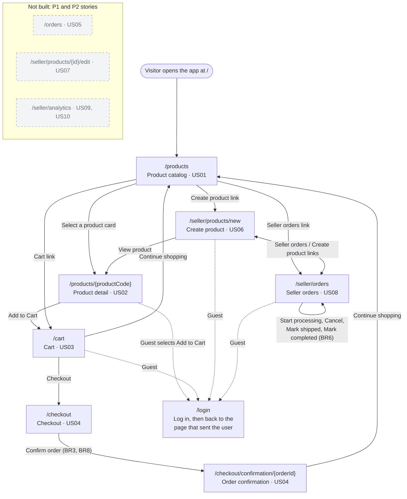

# UI documentation — Milestone 3

Mini Marketplace lets buyers find products, fill a cart and place an order, and lets
sellers list products and process their orders. This document has the four sections
Milestone 3 asks for, in order. Wireframes are drawn in text below; screenshots of
the running app are in [docs/images/ui/](images/ui/) and the full browser record is in
[docs/evidence/milestone3.md](evidence/milestone3.md). Every message quoted in
section 3 is checked against the code by `tests/test_ui_docs_contract.py`.
The P1 review and notification experience, including its shared navigation entry, is
documented in [US15 review and notifications](us15-review-notifications.md).

## 1. P0 stories and status

| Story | Screen(s) | Route | Status | Issue |
|---|---|---|---|---|
| US01 Browse the product catalog | Product catalog | `/products` | works | [#13](https://github.com/SE-FDA-NEU/G1_AI66A_SE/issues/13), [#77](https://github.com/SE-FDA-NEU/G1_AI66A_SE/issues/77) |
| US02 View product details | Product detail | `/products/{productCode}` | works | [#14](https://github.com/SE-FDA-NEU/G1_AI66A_SE/issues/14), [#78](https://github.com/SE-FDA-NEU/G1_AI66A_SE/issues/78) |
| US03 Manage the shopping cart | Cart | `/cart` | works | [#15](https://github.com/SE-FDA-NEU/G1_AI66A_SE/issues/15), [#79](https://github.com/SE-FDA-NEU/G1_AI66A_SE/issues/79) |
| US04 Place an order | Checkout, Order confirmation | `/checkout`, `/checkout/confirmation/{orderId}` | works | [#16](https://github.com/SE-FDA-NEU/G1_AI66A_SE/issues/16), [#80](https://github.com/SE-FDA-NEU/G1_AI66A_SE/issues/80) |
| US06 Create a product listing | Seller product form | `/seller/products/new` | works | [#18](https://github.com/SE-FDA-NEU/G1_AI66A_SE/issues/18), [#81](https://github.com/SE-FDA-NEU/G1_AI66A_SE/issues/81) |
| US08 Manage seller orders | Seller orders | `/seller/orders` | works | [#20](https://github.com/SE-FDA-NEU/G1_AI66A_SE/issues/20), [#82](https://github.com/SE-FDA-NEU/G1_AI66A_SE/issues/82) |

"works" means each story was completed in a browser on 2026-10-18 with the demo data
(`python -m src.seed --demo`), starting from `/` and using only links and buttons,
never a typed URL ([evidence](evidence/milestone3.md)). Sessions with people who have
never seen the app are planned in #83 and not recorded yet.

**Where each story starts.** Open the app at `/`; a browser lands on the catalog.
Test accounts are listed in [SETUP.md section 8.1](SETUP.md#81-choose-the-dataset);
every password is `password`.

| Story | Start | Account |
|---|---|---|
| US01 | The catalog opens at `/` | None |
| US02 | Select a product card in the catalog | None |
| US03 | **Cart** in the top navigation, or **Add to Cart** on a product | `user@example.com` |
| US04 | **Checkout** at the bottom of the cart | `user@example.com` |
| US06 | **Create product** in the top navigation | `seller@example.com` |
| US08 | **Seller orders** in the top navigation | `demo.seller@marketplace.local` |

### Screen flow, updated from M1



Source: [images/ui/screen-flow.mmd](images/ui/screen-flow.mmd) (Mermaid). Changes from
the M1 diagram in [requirements.md](requirements.md#screen-flow-diagram):

- Products are addressed by their public code: `/products/{productCode}`, not
  `/products/:productId`.
- Checkout ends on `/checkout/confirmation/{orderId}`. The M1 diagram went to
  `/orders`, but buyer order history (US05) is P1 and not built.
- Login is not a fixed step before checkout. Any protected action (Add to Cart, Cart,
  Checkout, Create product, Seller orders) sends a guest to `/login`, which returns to
  the page that sent them.
- The M1 "seller navigation bar" is the shared top navigation: **Create product** and
  **Seller orders** sit next to **Products** and **Cart**.
- `/` opens the catalog in a browser. This M3 diagram predates the later edit,
  order-history and analytics tasks. The current analytics UI is documented in
  [US18 #143](us18-seller-analytics-ui.md).

### Known limits

| Gap | What happens | Owner |
|---|---|---|
| UI-G1 | An unknown `/api/v1/...` path answers `{"detail": "Not Found"}` instead of the error envelope; no page calls such a path | @leducminh290506-eng (#75) |
| UI-G7 | The login button stays enabled and shows no "Signing in..." text while the request runs | @leducminh290506-eng (#75) |
| UI-G8 | The confirmation shows the product's current name; the price is the purchase-time price | @minhnm162 (#80) |

UI-G2 to UI-G6, found while writing the first version of this document, were fixed in
#85: the confirmation names each product, `/seller/orders` is linked from the
navigation, sends guests to login, explains network failures and keeps the list when
a status change fails.

US13 (#105) extends `/checkout` with an address book, available even when the cart is
empty. Buyers can add/edit six required fields, delete with confirmation and set a
default. The selector uses the default or smallest ID; manual entry is explicit.
Address and checkout forms are independent. Required fields show *, inline errors
have aria-invalid/aria-describedby and focus, and mobile cards wrap long addresses.
Pending checkout freezes changes and replays its stored body/key before loading
addresses. Stale versions require another selection after reviewing the refreshed book.
See [US13 verification](us13-addresses.md).

## 2. Wireframes

One wireframe per P0 screen, plus login. Each says why the user comes and which API
endpoints the page calls. The cart (2.3) is drawn in all four states.

### 2.1 Product catalog — `/products`

*The user comes here to find a product to buy.*
Calls: `GET /api/v1/products?page={page}&limit=20&search={text}`

```text
+--------------------------------------------------------------------+
|          Products  Cart  Create product  Seller orders  Log in     |
| Products                                                           |
| Search products [Search by product name                ] [Search]  |
| +-------------+ +-------------+ +-------------+ +-------------+    |
| | [image]     | | [image]     | | [image]     | | [image]     |    |
| | Wireless    | | Mechanical  | | USB-C Cable | | Laptop Stand|    |
| | Mouse       | | Keyboard    | |             | |             |    |
| | 180.000 ₫   | | 650.000 ₫   | | 90.000 ₫    | | 280.000 ₫   |    |
| | In Stock    | | Only 3 left | | In Stock    | | In Stock    |    |
| +-------------+ +-------------+ +-------------+ +-------------+    |
|                [Previous]   Page 1 of 3   [Next]                   |
+--------------------------------------------------------------------+
```

| State | What the user sees |
|---|---|
| Loading | Eight grey card skeletons |
| Data | 20 cards per page (image, name, price, "In Stock" or "Only N left"); only active products with stock (BR1) |
| Empty | "No products available at the moment." (also when a search finds nothing) |
| Error | "We could not load the products. Check your connection, then select Retry." and **Retry** |

A broken product image is replaced by a placeholder. Screenshots:
[loading](images/ui/catalog-loading.png), [data](images/ui/catalog-data.png),
[empty](images/ui/catalog-empty.png), [error](images/ui/catalog-error.png),
[mobile](images/ui/mobile-catalog.png).

### 2.2 Product detail — `/products/{productCode}`

*The user comes here to decide on one product and put it in the cart.*
Calls: `GET /api/v1/products/{productCode}`, `POST /api/v1/cart/items`

```text
+--------------------------------------------------------------------+
|                                     Products  Cart  Log in|Log out |
| <- Back to products                                                |
| +-------------------+   Wireless Mouse                             |
| |                   |   180.000 ₫                                  |
| |      [image]      |   Wireless mouse for study and office work   |
| |                   |   In Stock (10 available)                    |
| +-------------------+   Quantity [ 1 ]   [Add to Cart]             |
+--------------------------------------------------------------------+
```

| State | What the user sees |
|---|---|
| Loading | "Loading product…" |
| Data | Name, price, description, image, "In Stock (N available)" |
| Out of stock | "Out of stock"; **Add to Cart** is disabled |
| Not found | "This product does not exist or is no longer for sale. Go back to the catalogue to choose another one." and **Back to catalogue** |
| Error | "We could not load this product. Check your connection, then select Retry." with **Back to catalogue** and **Retry** |

A guest who selects **Add to Cart** goes to login and comes back to this product with
the chosen quantity, then selects **Add to Cart** again; success opens `/cart`.
Screenshots: [in stock](images/ui/detail-in-stock.png),
[out of stock](images/ui/detail-out-of-stock.png),
[not found](images/ui/detail-not-found.png).

### 2.3 Cart — `/cart` (all four states)

*The user comes here to check what they are buying and change quantities before
checkout.*
Calls: `GET /api/v1/cart`, `PATCH /api/v1/cart/items/{productCode}`,
`DELETE /api/v1/cart/items/{productCode}`,
`PATCH /api/v1/cart/items/{item_id}/select`, `PATCH /api/v1/cart/select-shop/{seller_id}`

```text
+- Empty -----------------------------+  +- Loading ---------------------------+
| Your cart is empty.                 |  | [~~~~~~~~~~~~~~~~~~~~~~~~~~~~~~~~~] |
| Total: 0 ₫                          |  | [~~~~~~~~~~~~~~~~~~~~~~~~~~~~~~~~~] |
| [ Continue shopping ]               |  | [~~~~~~~~~~~~~~~~~~~~~~~~~~~~~~~~~] |
+-------------------------------------+  +-------------------------------------+
+- Error -----------------------------+  +- Data ------------------------------+
| Unable to load your cart.           |  | [img] Demo cart item     [-] 2 [+] |
| Please try again.                   |  |       100.000 ₫ each    200.000 ₫  |
| [ Retry ]                           |  |       P-DEMO-CART · Available: 12  |
|                                     |  |                           Remove   |
|                                     |  | Total: 200.000 ₫                    |
|                                     |  | No shipping fee is added at         |
|                                     |  | checkout.                           |
|                                     |  | Continue shopping     [ Checkout ]  |
+-------------------------------------+  +-------------------------------------+
```

Inside the data state:

- A quantity above the available stock keeps the old quantity and shows "Cannot add
  more than 12 items (available stock limit)" beside the line (BR2).
- A typed quantity that is not a whole number of at least 1 shows "Enter a whole
  number of at least 1."
- A line whose product was withdrawn or ran out is kept and flagged ("This product is
  no longer available." or "This product is out of stock.") and deselected.
  **Checkout** requires at least one selected available item; unselected unavailable
  rows do not block it.
- A seller who opens the cart sees "The cart is for buyer accounts. Log in with a
  buyer account to shop." A guest goes to login and back.

Screenshots: [empty](images/ui/cart-empty.png), [loading](images/ui/cart-loading.png),
[error](images/ui/cart-error.png), [data](images/ui/cart-data.png),
[stock limit](images/ui/cart-stock-error.png), [seller](images/ui/cart-seller.png),
[mobile](images/ui/mobile-cart.png).

### 2.4 Checkout — `/checkout`

*The user comes here to give a delivery address and place the order.*
Calls: `GET /api/v1/auth/me`, `GET /api/v1/cart`, `POST /api/v1/orders`
(with an `Idempotency-Key` header)

```text
+--------------------------------------------------------------------+
| Mini Marketplace  Cart                                             |
| Checkout                                                           |
| Enter delivery information.                                        |
| Demo cart item × 2: 200.000 ₫                                      |
| Total: 200.000 ₫                                                   |
| Recipient name    [                                             ]  |
| Delivery address  [                                             ]  |
| Phone number      [                                             ]  |
| [Confirm order]                                                    |
| Back to cart · Continue shopping                                   |
+--------------------------------------------------------------------+
```

| State | What the user sees |
|---|---|
| Loading | "Loading your cart..." |
| Data | Cart summary, total and the delivery form |
| Empty | "Your cart is empty."; the form is hidden |
| Blocked | "Update unavailable items in your cart first."; the form is hidden |
| Submitting | Fields locked; "Placing your order..." |
| Error | The reason, for example "Phone number must contain 7 to 15 digits."; a refused order adds "Order was not confirmed. Your delivery information is preserved."; a timeout offers **Retry**, which resends the same request so only one order can exist |

Screenshots: [field error](images/ui/checkout-error.png),
[mobile](images/ui/mobile-checkout.png).

### 2.5 Order confirmation — `/checkout/confirmation/{orderId}`

*The user comes here to see that the order was placed and what it contains.*
Calls: `GET /api/v1/orders/{orderId}`

```text
+--------------------------------------------------------------------+
| Mini Marketplace  Cart                                             |
| Order confirmation                                                 |
| Order placed successfully.                                         |
| Order #5 · PENDING                                                 |
| Total: 200.000 ₫                                                   |
| Nguyen Minh Anh · 12 Le Loi, District 1 · 0912345678               |
| Demo cart item (P-DEMO-CART) × 2 · 100.000 ₫ each                  |
| Continue shopping                                                  |
+--------------------------------------------------------------------+
```

| State | What the user sees |
|---|---|
| Loading | "Loading confirmation..." |
| Data | "Order placed successfully." and the receipt |
| Error | "Confirmation unavailable." with the reason and **Retry**; another buyer's order shows "We could not find this order in your account. Check the order link, or continue shopping." (BR4) |

Screenshot: [confirmation](images/ui/confirmation.png).

### 2.6 Seller product creation — `/seller/products/new`

*The user, a seller, comes here to put a new product on sale.*
Calls: `GET /api/v1/auth/me`, `POST /api/v1/seller/products`

```text
+--------------------------------------------------------------------+
|                         Products  Create product  Seller orders    |
| Seller center › New product                                        |
| New product                                                        |
| Signed in as Demo Seller.                                          |
| +- Please correct the highlighted fields. ----------------------+  |
| | • Price must be greater than 0 ₫.                             |  |
| +---------------------------------------------------------------+  |
| Product name   [                                              ]    |
| Description    [                                              ]    |
| Price (₫)      [            ]    Stock quantity [            ]     |
|                Price must be greater than 0 ₫.                     |
| Image URL      [https://example.com/product.jpg               ]    |
| New listings are created active. A listing with stock 0 stays      |
| out of the catalog until it has stock.                             |
|                                       [Cancel] [Create listing]    |
+--------------------------------------------------------------------+
```

| State | What the user sees |
|---|---|
| Checking | "Checking your account…" |
| Data | The empty form |
| Submitting | Every field locked; "Creating listing..." |
| Error | Each message under its field and in the summary; focus on the first wrong field; typed values are kept |
| Success | "Listing created", the name, "Product code: P-…", **View product**, **Continue browsing**, **Create another product** |
| Not a seller | "Only seller accounts can create product listings." with **Log in as a seller** |

Screenshots: [errors](images/ui/product-form-errors.png),
[created](images/ui/product-created.png), [mobile](images/ui/mobile-product-form.png).

### 2.7 Seller order management — `/seller/orders`

*The user, a seller, comes here to see the orders for their products and move each one
to its next status.*
Calls: `GET /api/v1/seller/orders?status=&from=&to=&page=&limit=20`,
`PATCH /api/v1/seller/orders/{subOrderId}/status`

```text
+--------------------------------------------------------------------+
| Products  Create product  Seller orders  [Log out]                 |
| Seller orders                                                      |
| Status [All v]  From [mm/dd/yyyy]  To [mm/dd/yyyy]  [Filter]       |
| 3 seller orders found.                                             |
| +----------------------------------------------------------------+ |
| | Order #5 (parent #5)                                  PENDING  | |
| | Customer: Nguyen Minh Anh                                      | |
| | • Demo cart item × 2 (200.000 ₫)                               | |
| | [Start processing] [Cancel]                                    | |
| +----------------------------------------------------------------+ |
|                [Previous]   Page 1 of 1   [Next]                   |
+--------------------------------------------------------------------+
```

| State | What the user sees |
|---|---|
| Loading | "Loading orders…" |
| Data | One card per order with only the next allowed steps: **Start processing** and **Cancel** (PENDING), **Mark shipped** (PROCESSING), **Mark completed** (SHIPPED) |
| Empty | "No seller orders found." |
| Error | "Unable to load seller orders." with the reason, for example "We could not reach the server. Check your connection, then select Retry.", and **Retry** |
| Change failed | The list stays; the status line says "Order #5 was not updated." and why |

**Cancel** asks "Cancel this order and restore stock?" first. A guest goes to login
and back. Screenshots: [data](images/ui/seller-orders.png),
[empty](images/ui/seller-orders-empty.png),
[change failed](images/ui/seller-orders-update-error.png),
[buyer](images/ui/seller-orders-buyer.png),
[mobile](images/ui/mobile-seller-orders.png).

### 2.8 Login — `/login`

*The user comes here to sign in, usually because a protected action sent them.*
Calls: `POST /api/v1/auth/login`

```text
+----------------------------------------------+
|                                    Products  |
| Log in                                       |
| Email     [                              ]   |
| Password  [                              ]   |
| [Log in]                                     |
| Email or password is incorrect.              |
+----------------------------------------------+
```

After login the user returns to the page in `return_to`, otherwise `/products`.
Screenshots: [login](images/ui/login.png), [wrong password](images/ui/login-error.png).

### 2.9 Rules every screen follows

- Every action is a link or a button, so it works with the keyboard.
- A button is disabled while its request runs, so nothing is sent twice.
- Prices use the `vi-VN` format, for example `180.000 ₫`.
- Names, descriptions and server messages are shown as text, never as HTML.
- Protected pages send a guest to `/login?return_to=...` and come back afterwards.
- At 390 px wide no page scrolls sideways: the catalog shows two cards per row, cart
  lines stack, forms are one column and seller orders are cards.

## 3. Error messages

Each message says what happened and what to do next. The error codes are those of
the API table in [design.md section 3.4](design.md#34-error-handling). A message the
page writes itself is listed with the error code that leads to it.

| API error code | Business rule | The exact message the user sees | Where | Automated check |
|---|---|---|---|---|
| `500 ERR_DATABASE_FAILURE` | BR1 | `We could not load the products. Check your connection, then select Retry.` | Catalog | `test_list_products_database_failure_returns_500` |
| `404 ERR_PRODUCT_NOT_FOUND` | BR1 | `This product does not exist or is no longer for sale. Go back to the catalogue to choose another one.` | Product detail | `test_product_detail_hides_inactive_and_unknown_products` |
| `409 ERR_STOCK_EXCEEDED` | BR2 | `Cannot add more than {available} items (available stock limit)` | Cart, product detail | `test_quantity_above_stock_is_refused_and_the_previous_one_kept` |
| `409 ERR_PRODUCT_UNAVAILABLE` | BR2 | `This product is no longer available.` | Cart | `test_unknown_and_withdrawn_products_are_refused` |
| `400 ERR_INVALID_QUANTITY` (checked in the page first) | BR2 | `Enter a whole number of at least 1.` | Cart | `test_add_refuses_an_invalid_quantity` |
| `403 ERR_BUYER_REQUIRED` | BR3 | `The cart is for buyer accounts. Log in with a buyer account to shop.` | Cart | `test_seller_has_no_cart` |
| `409 ERR_STOCK_EXCEEDED` | BR8 | `Item {name} has insufficient stock or changed.` | Checkout | `test_stale_product_version_aborts_checkout` |
| `422 ERR_VALIDATION` (checked in the page first) | — | `Phone number must contain 7 to 15 digits.` | Checkout | `test_api_validation_does_not_write` |
| `400 ERR_EMPTY_CART` | — | `Your cart is empty.` | Checkout | `test_auth_empty_cart_key_and_pages` |
| `404 ERR_ORDER_NOT_FOUND` | BR4 | `We could not find this order in your account. Check the order link, or continue shopping.` | Order confirmation | `test_api_create_replay_and_ownership` |
| `422 ERR_VALIDATION` (`error.fields.price`) | BR9 | `Price must be greater than 0 ₫.` | Seller product form | `test_invalid_field_is_reported_beside_that_field_and_nothing_is_written` |
| `422 ERR_VALIDATION` (`error.fields.stock_quantity`) | BR9 | `Stock quantity must be 0 or more.` | Seller product form | `test_invalid_field_is_reported_beside_that_field_and_nothing_is_written` |
| `403 ERR_SELLER_REQUIRED` | BR5 | `Only seller accounts can create product listings.` | Seller product form | `test_guests_buyers_and_invalid_tokens_cannot_create` |
| `403 ERR_SELLER_REQUIRED` | BR6 | `Only seller accounts can manage orders. Log in with a seller account.` | Seller orders | `test_buyers_and_guests_cannot_use_seller_orders` |
| `400 ERR_INVALID_TRANSITION` | BR6 | `Order #{id} was not updated. Transition from {from} to {to} is not allowed.` | Seller orders | `test_invalid_transition_returns_business_error` |
| `401 ERR_INVALID_CREDENTIALS` | BR3 | `Email or password is incorrect.` | Login | `test_invalid_credentials_use_common_error_shape` |

`{...}` is filled in at run time, for example "Cannot add more than 12 items
(available stock limit)". A network failure on the seller order page shows "We could
not reach the server. Check your connection, then select Retry." No page shows
"Error 422", "Something went wrong" or a stack trace;
`test_pages_never_show_a_generic_error` fails if one appears.

## 4. What changed since M2

Building and checking the screens changed the API and data model of
[design.md](design.md) in these places. The first row is part of the same pull request
as this document (#85).

| Change in design.md | Why the interface needed it | Where in design.md | Issue / PR |
|---|---|---|---|
| Receipt items also return `product_code` and `product_name` | The confirmation screen showed "Product #46 × 2 · 100000 VND each", so a buyer could not tell what they had bought | Section 3.3 (`POST /api/v1/orders`, `GET /api/v1/orders/{orderId}`); section 6.4 | #85 |
| Seller product creation takes JSON with `image_url` and answers `422` with `error.fields` | The form must show each error beside its field, and it has no file upload | Sections 3.3, 3.4 and "US06 seller product creation implementation" | #81, PR #95 |
| Checkout needs an `Idempotency-Key`; `orders.request_key` and `orders.request_hash` were added | The checkout page retries after a timeout; without a key a retry could create a second order | Sections 3.3, 6.4 and "US04 atomic checkout implementation" | #80, PR #94 |
| `GET /` sends a browser to `/products` | Opening the app's address showed JSON instead of the shop | Section 6.4 and "Browser entry for P0 verification" | #83, PR #97 |
| `GET /api/v1/auth/me` is part of the contract | Checkout and the seller pages must know who is signed in, and their role, before showing a form | Section 3.3 | #75, #81 |

**Receipt names, in detail.** When we checked the confirmation screen against its
wireframe, the M2 contract only returned `product_id` for each order item, so the page
could not name the product. `OrderLine` now also carries `product_code` and
`product_name`, read from `products` when the receipt is built; `unit_price` stays the
price stored at checkout. The change adds fields only, so existing clients keep
working; it is recorded in design.md section 3.3 and in the section 6.4 table.


### US12 grouped cart selection (#104)

The cart groups rows by seller, supports persisted item/shop selection, displays
shop and selected totals, separates unavailable rows and discloses price changes.
Checkout shows and orders only selected items; unselected rows remain after success.
See [runtime contract, migration and acceptance checks](us12-cart-selection.md).
The earlier screenshots show Sprint 3; new US12 browser screenshots remain pending.

### US18 seller analytics (#143)

`/seller/analytics` and `/seller/analytics/products` show separate financial
metrics, a selectable SVG time series with exact-value table, date/day/month
filters and a units-based product ranking. Loading, empty, error and current-API
fallback states remain explicit. See the [scope and API boundary](us18-seller-analytics-ui.md)
and [single verification matrix](testing.md#task-143-seller-analytics-charts-and-ranking).

### US17 buyer return requests (#139)

On either order-detail alias, buyers can request a return/refund for a delivered
shop order, enter reason/evidence, correct validation errors and read every
request's status. Drafts remain attached to each shop, duplicate clicks are locked,
and uncertain submissions require a status read before another attempt.
See the [buyer UI contract and screenshots](us17-buyer-returns.md) and
[test matrix](testing.md#task-139-buyer-return-request-ui). Existing seller/admin
decisions and backend refund/restock rules are unchanged.
