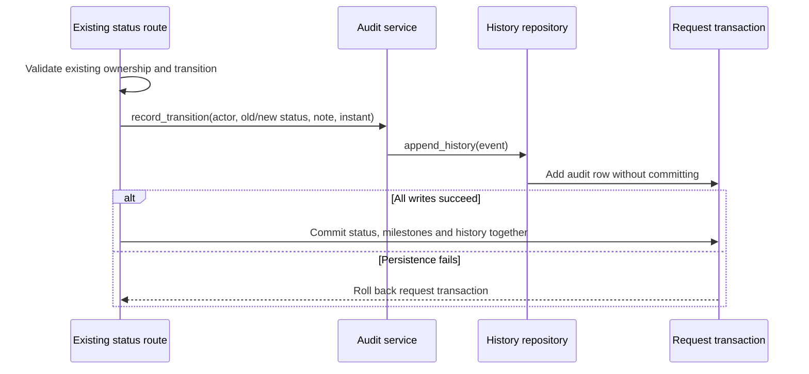

# US14 / task #127: order history and shipping milestones

Parent story: #106. Scope: persist and return audit history, actor-role snapshots
and existing shipping milestones. Tracking/milestone columns and transition rules
already exist on `main`; this task reuses them. It does not add screens, change the
state machine (#126), redesign cancellation side effects (#128), change inventory
concurrency (#129), or implement payments.

## Data contract

Each `order_history` row records `seller_order_id`, `from_status`, `to_status`,
`changed_by_user_id`, `actor_role`, `note` and `created_at`.

- `changed_by_user_id` and `actor_role` come from the authenticated actor passed
  into the existing use case. Requests cannot supply either field.
- `actor_role` is captured when the event happens. A later account-role change
  does not rewrite old history. The existing buyer/seller, return/refund and admin
  dispute paths all use the same audit service.
- Existing rows get `actor_role = null`: the historical role was not stored, and
  looking up today's user role would invent an audit fact. `migrate_db()` adds the
  nullable column once, preserving rows and timestamps on every rerun.
- Events are appended inside the existing status-change transaction. Neither the
  service nor repository commits. If audit persistence fails, the transition and
  its milestone changes roll back with the request session.
- Shipping/delivery history uses the same UTC instant as the corresponding
  seller-order milestone. Later completion retains the earlier milestones.

## Existing API extensions

Both status-update endpoints accept the same additive `note` field and validate
the existing tracking number consistently:

```text
PATCH /api/v1/orders/{order_id}/status
PATCH /api/v1/seller/orders/{sub_order_id}/status
```

Example body:

```json
{"status":"SHIPPED","tracking_number":"VN-127","note":"Handed to carrier"}
```

`tracking_number` remains optional for compatibility with existing clients. When
provided it is trimmed and must contain 1-100 characters; `note` is optional,
trimmed and at most 1000 characters. With no supplied note, existing generated
transition notes are retained. Invalid input or extra actor fields return
`422 ERR_VALIDATION` in the common error envelope. Existing authorization,
transition and concurrency error codes/statuses are unchanged.

Reads expose history without a new endpoint:

| Existing response | Added field / shipping behavior |
|---|---|
| Order detail/list and status responses | Each visible `data.sub_orders[]` includes `history` |
| Seller order list/status response | Each seller-order data object includes `history` |
| Owning seller's order receipt | Top-level tracking/milestones reflect that seller's sub-order, rather than another shop's latest parent metadata |

An entry has `id`, `seller_order_id`, `from_status`, `to_status`,
`changed_by_user_id`, `actor_role`, `note` and a UTC `created_at`. No events returns
`history: []`. Ordering is ascending `(created_at, id)`, so timestamp ties are
deterministic. Buyers see their order's seller-order histories; a seller sees only
their own. History is fetched in one batch for the visible seller orders, avoiding
an additional history query for every card. No write/update/delete history endpoint
is introduced, and response values are read from persisted events.

`tracking_number`, `shipped_at` and `delivered_at` remain available on each
sub-order and seller-order response. For multi-shop buyer orders, per-shop fields
are authoritative; the existing parent aggregate fields remain a legacy summary.
No shipment or tracking number is fabricated for existing orders.

## Architecture decision

Options considered: add actor-role assignments independently to every writer, or
use one audit service with a dedicated persistence module. Chosen: shared service
and repository, so all current transition paths snapshot roles the same way and
the service can be tested without HTTP or a database. This buys maintainability
and audit consistency, following the course's week 7-8/10 layering guidance.



This is a focused extraction of audit persistence, not a rewrite of the existing
transition controllers. Their older orchestration remains in place. Revisit the
design if event volumes require a separately paginated audit API; it does not
justify a new network service for this small monolith.

## Verification

Cases and expected results are in [testing.md](testing.md#task-127-order-history-and-shipping-milestones).

```text
python -m pytest tests/test_order_history_milestones.py -q
python -m pytest tests/test_seller_orders.py tests/test_order_tracker.py tests/test_return_refund.py tests/test_admin_portal.py -q
python -m ruff check src tests/test_order_history_milestones.py
```

The new regression tests were first run against the old implementation (missing
role snapshots/history/validation/migration failed), then used to verify the
change. They use isolated SQLite files and injected clocks/failures, not real
customer data. Local verification and automated tests do not claim human
acceptance, external review, a clean-clone run, successful CI or merge.

AI assistance: OpenAI Codex helped inspect the supplied course slides, draft the
scoped implementation/tests, and run checks. Human review and the ability to
explain the code remain the author's responsibility.
